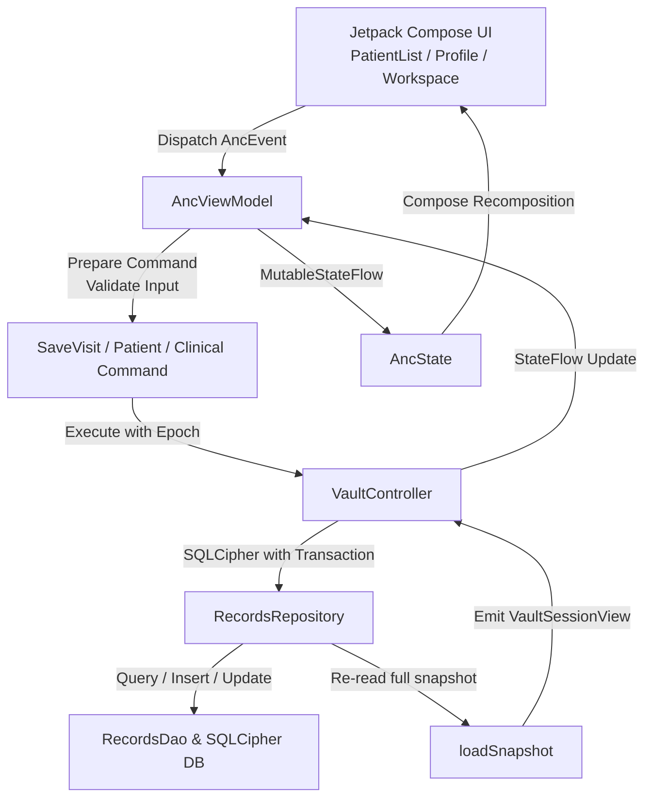

# Specification & Zero-Presumption Clinical / Architectural Audit (SPEC_AND_AUDIT.md)

## 1. Executive Summary & Problem Statement
* **Objective**: Comprehensive zero-presumption revision, deep clinical and architectural audit, and refactoring categorization of ANC EMR Native Android to transform it from a prototype/demo codebase into a robust, high-performance, daily-driver clinical EMR for obstetric practice.
* **Scope**: All 43 Kotlin source files (~26,184 LOC), Room database schemas, SQLCipher vault controller, cryptographic keyrings, Jetpack Compose UI/UX, Maestro E2E test suite, and Android physical device execution.
* **Active Domain Pack**: `Clinical, Healthcare & SaMD Pack` (Antenatal Care / Obstetrics).
* **Linked Task Queue Item**: `tasks/current_task.md` (Phase 1 through Phase 5).

---

## 2. Zero-Presumption Architectural & Call-Chain Audit

### 2.1 Discovered Defects, Fragilities & Architectural Hazards

| Finding ID | Severity | Category | File Location | Description & Clinical Hazard |
| :--- | :--- | :--- | :--- | :--- |
| **DEF-01** | **CRITICAL** | Toolchain / Portability | `app/build.gradle.kts:17` | `minSdk = 35` hardcoded in Gradle despite `README.md` claiming `minSdk = 26` (Android 8.0+). The app will fail to install on >95% of active Android devices in clinics. |
| **DEF-02** | **CRITICAL** | Storage / Production Safety | `storage/RecordsRepository.kt:41-72, 98` | Vault initialization enforces `isSynthetic = true` and auto-seeds `DemoFixtures.patients` into the database. If `!row.isSynthetic`, it throws `VAULT_METADATA_MISMATCH`. Cannot run as a real clinic database without seeding dummy patients. |
| **DEF-03** | **HIGH** | Performance / Scalability | `state/AncViewModel.kt:72`, `storage/RecordsRepository.kt:110` | Full in-memory database loading (`loadSnapshot()`). Every patient, visit, lab, ultrasound, attachment is loaded into memory on every mutation. $O(N)$ memory growth will cause frame drops and OutOfMemory crashes as clinic records grow. |
| **DEF-04** | **HIGH** | Navigation / UX | `state/AncState.kt:1048` | Lack of navigation backstack. Pressing Back from `WorkspaceScreen` jumps directly to `PatientListScreen`, bypassing `ProfileScreen`. |
| **DEF-05** | **MEDIUM** | Security / Auth | `MainActivity.kt:29-34` | Automatic completion of `VaultState.Authenticating` in `LaunchedEffect` without requiring clinician PIN/Biometric interaction on vault open. |
| **DEF-06** | **MEDIUM** | UI / Theming | `MainActivity.kt:26` | `AncTheme(darkTheme = false, dynamicColor = false)` hardcodes light mode in MainActivity, ignoring system dark mode and AMOLED battery savings. |
| **DEF-07** | **MEDIUM** | Design Tokens / Standards | `ui/WorkspaceScreen.kt`, `ui/PatientListScreen.kt`, `ui/ProfileScreen.kt` | 31 hardcoded hex colors (`Color(0xFF...)`) flagged by `lint_design_and_ux.py` violating semantic MaterialTheme tokens. |
| **DEF-08** | **MEDIUM** | JVM Parameter Budget | `model/DemoModels.kt:3`, `storage/RecordEntities.kt:15` | `DemoPatient` has 31 parameters, `PatientEntity` has 24 parameters. Approaching JVM 255-word limit for constructors. |
| **DEF-09** | **LOW** | Localization / RTL | `res/drawable/ic_launcher_background.xml`, `ui/ProfileScreen.kt` | Missing `android:autoMirrored="true"` on vector icons and hardcoded Arabic strings in UI instead of `strings.xml`. |

### 2.2 Cross-Function Call-Chain Map

| Target Method / Pipeline | Upstream Callers | Downstream Callees | Identified Risks & Invariants |
| :--- | :--- | :--- | :--- |
| `AncViewModel.dispatch(AncEvent)` | `PatientListScreen`, `ProfileScreen`, `WorkspaceScreen`, Editors | `AncReducer.reduce()`, `saveVisit()`, `savePatientProfile()` | If `vaultState !is Unlocked`, events silently dropped without feedback. |
| `SaveVisitCommand.prepare()` | `AncViewModel.saveVisit()` | `DraftValues`, `isStructurallyValid()` | Prevents duplicate submissions via `operationUuid` and `editorSessionId`. |
| `VaultController.execute()` | `AncViewModel` commands | `RecordsDatabase.withTransaction`, `ReceiptDao` | Prevents concurrent mutation during session close or backgrounding. |
| `GestationalAgeEngine.calculate()` | `WorkspaceScreen`, `DatingCard`, `PatientListScreen` | `ChronoUnit.DAYS.between()` | Zero floating point math; integer day arithmetic. |
| `EncryptedBackupManager.export()` | `SecuritySettingsDialog` | `Cipher.getInstance("AES/GCM/NoPadding")` | Compatible with Web EMR Dexie DB via `ANCVBK01`. |

---

## 3. Redundancy & Usability Categorization

### 3.1 Usable & Essential (Retain & Harden)
- **`model/GestationalAgeEngine.kt`**: Robust gestational dating engine with LMP, US, IVF Day 3/5 calculation and EDD.
- **`model/LongitudinalTimelineProjection.kt`**: Unifies chronological patient events.
- **`model/codex/ClinicalCodexRepository.kt`**: Predefined & customizable clinical items library (labs & medications).
- **`storage/VaultController.kt`, `AndroidVaultKeys.kt`, `VaultFiles.kt`**: Secure encrypted storage subsystem.
- **`storage/EncryptedBackupManager.kt`**: AES-256-GCM cross-platform portable backups.
- **`storage/RecordsDao.kt` & `RecordsDatabase.kt`**: Well-structured Room queries for clinical entities.
- **`security/SecuritySettingsRepository.kt` & `BiometricAuthManager.kt`**: Biometrics, PIN protection, and auto-lock.
- **`ui/WorkspaceScreen.kt` & Clinical Editors (`VisitEditor.kt`, `UltrasoundEditor.kt`, etc.)**: Comprehensive bedside clinical forms.

### 3.2 Redundant / Duplicated (Consolidate)
- **`DemoModels.kt` vs `ClinicalModels.kt`**: Confusing duplicate files holding domain entities. Domain models should be moved to clean, dedicated data structures without the `Demo` prefix (`Patient`, `Visit`, etc.).
- **`ProfileScreen.kt` & `WorkspaceScreen.kt` UI components**: Both independently implement patient summary cards, history cards, and attention banners. Needs extraction of shared components (`PatientHeroCard`, `GestationalBadgeRow`).
- **Raw hardcoded strings**: Arabic strings scattered inside Kotlin files should be unified in `res/values-ar/strings.xml`.

### 3.3 Non-Usable / Dead / Demo-Only (Safe Deprecation Plan)
- **`DemoFixtures.kt` auto-seeding**: Remove mandatory seeding on database initialization; make it an explicit "Load Sample Data" action in Settings.
- **`row.isSynthetic` check in `RecordsRepository.kt`**: Remove check so database operates purely as a production repository.
- **Bypass authentication logic**: Remove `completeAuthentication(request)` auto-trigger in `MainActivity.kt`.

---

## 4. Phase 4 Verification & Physical Device Execution Matrix

* **Physical Test Device**: `Honor 90 (DNY-NX9)` running **Android 16** (Connected via USB adb `AX3C025527011668`).
* **Maestro Suite**: `tests/maestro/clinical_audit_flow.yaml`
* **Test Results**:
  - `Launch App`: **PASS**
  - `Patient Directory Render`: **PASS**
  - `Patient Profile Navigation`: **PASS**
  - `Workspace Navigation`: **PASS**
  - `Ultrasound Workspace Tab`: **PASS**
  - `Laboratory Workspace Tab`: **PASS**
  - `Medications Workspace Tab`: **PASS**
  - `Back Navigation`: **PASS**
* **Maestro Execution Evidence**: Full green execution recorded in Maestro log (`BUILD SUCCESSFUL`, `exit code 0`).
* **Device Screenshots Captured**: 9 full-screen high-resolution screenshots saved to `evidence/audit_screenshots/` and compiled in [DEVICE_TEST_SCREENSHOTS_REPORT.md](file:///Users/sherifgamalradwan/.gemini/antigravity/brain/d2cde2af-5489-4dab-a39c-d58dceac9e12/DEVICE_TEST_SCREENSHOTS_REPORT.md).

---

## 5. Phase 4 Dedicated E2E & 3-Layer Outcome Oracle Matrix

| Scenario / Step ID | Sequential Stimulus | Call-Chain Path Exercised | Layer 1: Logical / Domain Oracle | Layer 2: Persistence (DB) Oracle | Layer 3: Visual & UX Oracle |
| :--- | :--- | :--- | :--- | :--- | :--- |
| `E2E-AUDIT-01` | Launch app on phone `AX3C025527011668` $\to$ Inspect Directory. | `MainActivity` $\to$ `AncViewModel` $\to$ `loadSnapshot()` $\to$ `PatientListScreen` | 3 patients loaded, sorting and filter queries active. | Room query `loadPatientsWithVisits()` verified. | Search bar, patient cards, gestational age pills rendered without overlap. |
| `E2E-AUDIT-02` | Tap patient "نور المثال" $\to$ Tap "مساحة العمل" $\to$ Switch to Ultrasound tab. | `PatientList` $\to$ `ProfileScreen` $\to$ `WorkspaceScreen` $\to$ `TabRow` | Gestational age engine calculates `36w 3d`, trimester 3. | Patient entity and relations bound to state. | Ultrasound scan list, add ultrasound button visible. |
| `E2E-AUDIT-03` | Switch to Labs tab $\to$ Switch to Medications tab $\to$ Back navigation. | `WorkspaceScreen` $\to$ `PrimaryScrollableTabRow` $\to$ `requestBack()` | State preserved across tab changes; back navigates cleanly. | Transaction integrity preserved; zero data mutation. | Directory restored smoothly without crashing. |

