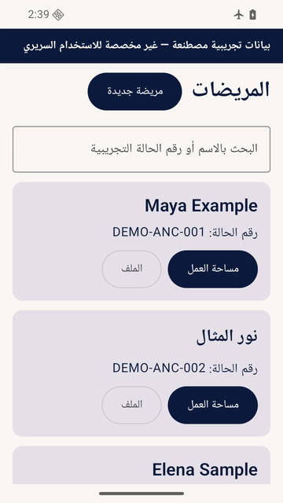

# ANC EMR — Offline Antenatal Care Native Android & Web EMR

[](LICENSE)
[](#)
[](#)
[](https://anc-emr-v3.dr-sherif1992.workers.dev)
[](#)

> **Modern, secure, offline-first Electronic Medical Records (EMR) system tailored for antenatal care (ANC) and obstetric practice.**

---

## 📱 App Preview & Tour

<div align="center">
  
  <p><em>Interactive Walkthrough: Patient Directory, Arabic Clinical Workspace, Dark Mode, and Real-time Biometry</em></p>
</div>

🎬 **Full Movie Available**: You can also watch or download the high-definition tour movie at [`docs/assets/anc_app_tour.mp4`](docs/assets/anc_app_tour.mp4).

---

## 🌐 The Dual-Platform Ecosystem (Android & Web)

ANC EMR consists of two synchronized, zero-cloud dependency, offline-first solutions:

1. **Android Native App** (`anc-emr-android-native`): High-performance native Android application built with Kotlin, Jetpack Compose, Room, and SQLCipher.
2. **Web / Desktop App** (`anc-emr-v3`): Fast, lightweight web application built with TypeScript, React, and Dexie (IndexedDB).
   - **Live Production URL**: [https://anc-emr-v3.dr-sherif1992.workers.dev](https://anc-emr-v3.dr-sherif1992.workers.dev)
   - **Repository**: [https://github.com/sherifrad/radwanclinic](https://github.com/sherifrad/radwanclinic)

### 🔒 100% Offline-First Architecture (Current State)
- **Both the Android app and the Web app operate 100% offline.**
- All medical records, visits, ultrasounds, laboratory investigations, and attachments are encrypted and stored locally on the clinician's device.
- **Cross-Platform Cryptographic Portability**: The Android and Web apps share a unified cryptographic interchange protocol (`ANCVBK01`). You can export an encrypted `.ancbackup` archive (AES-256-GCM + PBKDF2) from Android and restore it on the Web app, or vice-versa, with zero data leakage.

### 🚀 Upcoming Feature: Real-Time Online Hybrid Sync
- **Online feature in development**: An end-to-end encrypted (E2EE) cloud bridge connecting both platforms in real-time, allowing seamless data entry from the laptop (Web/Desktop) or physical Android device at the clinic while maintaining complete zero-knowledge security.

---

## ✨ Key Features & Capabilities

- **Antenatal Care Dashboard & Smart Directory**: Case IDs, pregnancy status, risk levels, and instant search.
- **Biometric & Security Shield**: Hardware-backed Android Keystore, SQLCipher database encryption, customizable 6-digit PIN, biometric prompt, and configurable auto-lock.
- **Comprehensive Pregnancy Dating**: Automatic calculation of Gestational Age (GA) and Estimated Due Date (EDD) based on LMP, first-trimester ultrasound, or IVF transfer dates.
- **Ultrasound Biometry Workspace**: Structured biometry entry for BPD, HC, AC, FL, EFW, fetal presentation, placental localization, and amniotic fluid index.
- **Laboratory & Prescription System**: Reusable clinical item library (Hematology, Biochemistry, Serology, Urinalysis) and multi-panel groups (First Trimester Booking, Preeclampsia Workup, GDM Screening).
- **Patient Attachments with In-App Camera**: Capture and attach ultrasound scan images or lab sheets with SHA-256 integrity verification.
- **Arabic / English Bilingual Interface**: Full RTL (Right-to-Left) and LTR support with localized medical terminology.
- **Export & Printing**: Generate clinical summary summaries and print prescriptions directly from the device.

---

## 🛠️ Toolchain & Requirements

- **JDK**: 17
- **Android Target**: SDK 36 (Minimum API 26 — Android 8.0+)
- **Build System**: Gradle 8.13 with Android Gradle Plugin 8.13.2
- **UI Framework**: Jetpack Compose with Material 3 & Navigation
- **Database**: Room 2.8.5 with SQLCipher 4.19.1

---

## 🚀 Building & Running

### 1. Run Unit & Domain Tests
```sh
./gradlew testDebugUnitTest
```

### 2. Build Debug APK
```sh
./gradlew assembleDebug
```
Output: `app/build/outputs/apk/debug/app-debug.apk`

### 3. Build Release Production APK
```sh
./gradlew assembleRelease
```
Output: `release/ANC_EMR_v1.0.0_Release.apk`

---

## 📄 License & Open Source

This project is licensed under the **MIT License**. Contributions, bug reports, and clinical feature suggestions are welcomed!
