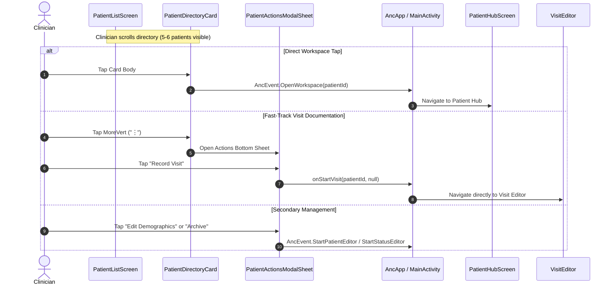

# High-Density Patient Directory Card & Actions Sheet Redesign

*   **Author:** sherifrad
*   **Status:** Draft
*   **Date:** 2026-11-09

--------------------------------------------------------------------------------

## Overview

This design document specifies the visual, architectural, and interaction overhaul of the primary patient directory (`PatientListScreen`). It replaces oversized, variable-height cards (~180–220dp) with a standardized, high-density clinical card (`Modifier.heightIn(min = 104.dp)`) that renders a structured 3-column metric grid (Gestational Age & EDD, Obstetric Parity & History, Bedside Vitals/BP with color-coded safety indicators). It eliminates triple-redundant click affordances in favor of single-tap workspace navigation, replaces the bloated footer with a consolidated 4-action clinical bottom sheet, and enforces strict start-alignment across all patients regardless of language script.

## The Problem

1. **Low Information Density & Excessive Scrolling**: Each card currently consumes 180–220dp of vertical space, showing only 2 to 3 patients on standard mobile viewports. High-volume obstetric rounds require clinicians to scan 30–50 patients efficiently.
2. **Ragged Badging & Visual Disorientation**: Up to 5 clinical badges (Risk level, Severe BP, Parity GPA, Age, Blood Group) wrap unpredictably inside an unconstrained `FlowRow`, causing adjacent cards to vary in height and forcing the clinician's eye to zig-zag across rows.
3. **Triple-Redundant Click Affordances & Footer Bloat**: The card container, the bottom sheet menu, and two floating icon buttons (`EditNote` and `AccountCircle`) all perform the identical action (`AncEvent.OpenWorkspace`). The floating buttons waste ~48dp of height for zero functional benefit.
4. **BiDi Alignment Inconsistency**: Arabic patient names align to the far right while Latin clinical metrics (`GA 38+3 wks · EDD 2026-11-20`) align to the far left, creating disjointed, ragged scanning patterns across mixed patient rosters.
5. **Intrusive Alert Boxes**: Every patient card renders an oversized salmon-tinted callout box for minor notes, creating visual noise and masking critical safety alerts like severe pre-eclampsia.

## Goals

*   **Standardize High-Density Card Envelope**: Implement `Modifier.heightIn(min = 104.dp)` (~108–112dp standard height) displaying 5–6 patients simultaneously on a 360dp–412dp screen without text truncation.
*   **Structured 3-Column Clinical Micro-Grid**: Allocate predictable column positions on 360dp viewports (~100dp / ~104dp / ~100dp):
    *   Column 1: Gestational Age (`34+2 wks`) and EDD (`Due 14 Nov 2026`).
    *   Column 2: Obstetric Parity (`G3 P2 A0`) and prior delivery tags (`Prev: 2x C/S`).
    *   Column 3: Bedside Vitals (`120/80 mmHg`) with color-coded alerts and a standardized placeholder (`BP: --/--`) for new patients.
*   **Ambient 3.5dp Severity Accent Strip**: Replace the bloated callout box with a leading-edge color bar (Red for Severe BP / High Risk, Amber for Medium Risk, Neutral for Low Risk).
*   **Consolidated Clinical Actions Bottom Sheet**: Streamline the "⋮" menu into 4 primary actions: New Visit (`onStartVisit`), Open Chart (`AncEvent.OpenWorkspace`), Edit Demographics (`AncEvent.StartPatientEditor`), and Archive/Restore (`AncEvent.StartStatusEditor`).
*   **Strict Start-Alignment**: Anchor all card containers and column layouts to the start edge (LTR) while preserving content-aware script rendering for Arabic patient names.
*   **Maintain SAMD Safety & Schema v6 Invariant**: Zero SQLite Room database migrations; zero regression in gestational age calculations or blood pressure thresholds.

## Non-Goals

*   **No Multi-Column Desktop Spreadsheet on Mobile**: No horizontally scrolling desktop data grid on 360dp mobile phones.
*   **No Database Schema Changes**: No Room entity or database schema modifications; all new projections are computed in-memory.
*   **No Alterations to Clinical Algorithms**: Core gestational age engines, blood pressure staging rules, and codex validation logic remain untouched.

## Open Questions

*   None. (All core design trade-offs regarding accessibility font scaling, missing vitals placeholders, and leading accent lines were resolved during brainstorming).

## Critical User Journeys (CUJs)

### CUJ 1: High-Volume Roster Scanning at Morning Rounds
*   **Given**: An obstetrician opens `PatientListScreen` on a 360dp phone with 35 active patients.
*   **When**: The clinician scrolls through the patient directory.
*   **Then**: 5–6 patients are visible per screen; Column 1 clearly displays GA/EDD, Column 2 shows parity history, Column 3 displays latest BP, and patients with severe pre-eclampsia are immediately identifiable by a prominent 3.5dp red leading border and red BP badge.

### CUJ 2: Fast-Track Direct Visit Documentation
*   **Given**: A clinician identifies a walk-in patient in the directory.
*   **When**: The clinician taps the "⋮" menu button on the patient's card and selects "New Visit".
*   **Then**: The app navigates directly to the Visit Editor pre-populated with the patient's context, bypassing the intermediate chart overview.

### CUJ 3: Seamless Chart Navigation
*   **Given**: A clinician wants to inspect ultrasound scans or laboratory reports for a patient.
*   **When**: The clinician taps anywhere on the patient card body.
*   **Then**: The app emits `AncEvent.OpenWorkspace` and navigates cleanly into the Patient Workspace.


--------------------------------------------------------------------------------

## Technical Plan (Architecture)

### 1. Architectural Overview & Component Decomposition

The current monolithic `PatientDirectoryCard` in `PatientListScreen.kt` (lines 563–763) is decomposed into three discrete, single-responsibility composables located directly within `PatientListScreen.kt`:

1.  **`PatientDirectoryCard` (Parent Container)**:
    *   Enforces `Modifier.fillMaxWidth().heightIn(min = 104.dp)`.
    *   Attaches `Modifier.clickable { onEvent(AncEvent.OpenWorkspace(patient.id)) }` to the entire card body.
    *   Renders an ambient 3.5dp leading-edge indicator line inside the card border mapping directly to clinical risk and severe blood pressure status.
    *   Maintains strict LTR / Start-aligned container coordinates across all cards.
2.  **`PatientDirectoryCardHeader`**:
    *   Renders the patient's display name (`weight(1f)`, `maxLines = 1`, `overflow = TextOverflow.Ellipsis`).
    *   Renders the canonical `ClinicalRiskBadge` (or `BpAlertLabel` if severe BP is detected).
    *   Renders the isolated `MoreVert` ("⋮") icon button with `Modifier.minimumTouchTarget()` ($\ge 48\,\text{dp}$) and `testTag("patientMenu-${patient.caseId}")` to trigger the actions sheet.
3.  **`PatientDirectoryMetricsRow` (3-Column Micro-Grid)**:
    *   Allocates a horizontal `Row` containing three equal `Modifier.weight(1f)` columns (~100dp / ~104dp / ~100dp on a 360dp device):
        *   **Column 1 (`GestationalAgeColumn`)**: Primary: bold GA text (e.g., `34+2 wks` or `Pending`). Secondary: muted EDD text (e.g., `Due 14 Nov`). Highlights with post-term badge if $\ge 41$ weeks.
        *   **Column 2 (`ObstetricHistoryColumn`)**: Primary: bold parity summary (`G3 P2 A0`). Secondary: prior delivery tags (e.g., `Prev: 2x C/S` or `Nulliparous`).
        *   **Column 3 (`BedsideVitalsColumn`)**: Primary: bold latest blood pressure (e.g., `120/80 mmHg`) with color threshold flags (`ActionRose` for severe BP $\ge 160/110$, `TagHighRiskText` for stage 1/2 HTN, green check for normal). Secondary: maternal pulse or blood group (`HR 82 · Rh+`). Displays `BP: --/--` placeholder when no visits exist.
4.  **`PatientActionsModalSheet`**:
    *   Replaces the legacy 4-item list with a clean clinical modal bottom sheet containing 4 non-redundant actions:
        1.  **Record Visit**: Triggers `onStartVisit(patient.id, null)` (direct documentation without chart detour).
        2.  **Open Chart / Workspace**: Emits `AncEvent.OpenWorkspace(patient.id)`.
        3.  **Edit Demographics**: Emits `AncEvent.StartPatientEditor(patient.id, ...)`.
        4.  **Archive / Restore Patient**: Emits `AncEvent.StartStatusEditor(...)`.

---

### 2. Visual Blueprint & Layout Structure

```text
+-----------------------------------------------------------------------------------+
|[Accent]  [Patient Name]                                    [HIGH RISK]        [⋮] | <- Header (~32dp)
|  3.5dp  |                                                                         |
|  Line   |  [ Col 1: GA & EDD ]      [ Col 2: Parity ]       [ Col 3: Vitals ]     | <- Micro-Grid
| (Rose / |  34+2 wks                 G3 P2 A0                140/90 mmHg           |    (~56dp)
|  Amber) |  Due 14 Nov 2026          Prev: 2x C-Section      HR 84 bpm · O+        |
+-----------------------------------------------------------------------------------+
Min Height: 104dp | Natural Rest Height: ~108-112dp | Zero Horizontal Truncation at 360dp
```

---

### 3. In-Memory Data Projection Enhancements (`PatientDashboardRowProjection`)

To feed the 3-column micro-grid without executing runtime database queries or altering Room schema v6, `projectDashboardRow(patient)` in `PatientListScreen.kt` is enhanced in-memory:

```kotlin
data class PatientDashboardRowProjection(
    val id: String,
    val caseId: String,
    val displayName: String,
    val obstetricSummary: String,
    val gestationalAgeText: String,
    val eddText: String?,
    val bloodGroup: String?,
    val isRhNegative: Boolean,
    val isRhPositive: Boolean,
    val isHighRisk: Boolean,
    val riskTier: PatientRiskTier,
    val clinicalAttention: String?,
    // New high-density projections:
    val latestVitalsBp: String?,
    val latestVitalsPulse: String?,
    val isSevereBp: Boolean,
    val isPostTerm: Boolean,
)
```

*   `latestVitalsBp`: Extracted from the most recent visit `patient.visits.maxByOrNull { it.date }?.bloodPressure?.formatted`. If no visits exist, returns `null`.
*   `latestVitalsPulse`: Extracted from `patient.visits.maxByOrNull { it.date }?.pulseBpm?.let { "$it bpm" }`.
*   `isSevereBp`: Evaluated via `severeBpAttention(patient) != null`.
*   `isPostTerm`: Evaluated via `patient.dating?.calculateGestationalAgeResult()?.isPostTerm == true`.

---

### 4. Data Flow & Event Routing



---

### 5. Viewport & Safety Invariants

*   **360dp Viewport Math**: On a 360dp phone, outer horizontal padding is 16dp on each side ($360 - 32 = 328\,\text{dp}$). Card inner padding is 10dp on each side ($328 - 20 = 308\,\text{dp}$). Three equal columns have ~102dp width each. With 12sp bold typography, `34+2 wks` occupies ~52dp, `G3 P2 A0` occupies ~58dp, and `140/90 mmHg` occupies ~74dp—guaranteeing zero text truncation.
*   **Touch Bounds**: Card body covers the full $328 \times 108\,\text{dp}$ touch area. The "⋮" menu button is padded to $48 \times 48\,\text{dp}$.
*   **Database Invariant**: Schema v6 is frozen; all projections operate on immutable in-memory state slices.


--------------------------------------------------------------------------------

## Alternatives Considered

### Alternative 1: Full Tabular Data Grid (Spreadsheet-Style Columns)

*   **Description**: Render a desktop-style data table with dedicated column headers (`Patient Name`, `Case ID`, `GA`, `EDD`, `Parity`, `Vitals`, `Risk Tier`, `Actions`) across all devices.
*   **Pros**:
    *   Maximum vertical density (40–48dp row height).
    *   Familiar spreadsheet interface for sorting and tabular comparison.
*   **Cons**:
    *   Violates the 360dp narrow viewport safety invariant: 6+ columns require either severe text truncation or horizontal scrolling.
    *   Horizontal scrolling hides life-critical clinical indicators (such as severe pre-eclampsia alerts or high-risk tags) off-screen.
    *   Horizontal pan gestures conflict with vertical scrolling on mobile touchscreens.
*   **Reason for Rejection**: *Rejected by author*: Unacceptable clinical safety hazard on handheld mobile devices due to off-screen alert hiding and high probability of mis-reading truncated clinical metrics.

---

### Alternative 2: Compact Master Row with Tap-to-Expand Accordion

*   **Description**: Collapsed rows at ~64dp showing only Patient Name, GA, and a risk chip; tapping a row expands it inline to ~140dp to reveal parity, vitals, and attention notes.
*   **Pros**:
    *   Allows 8–10 collapsed patient rows per screen.
    *   Clean, minimalist aesthetic when collapsed.
*   **Cons**:
    *   Forces extra taps during rapid clinical rounds; obstetricians cannot scan and compare blood pressures or gestational ages across patients at a glance.
    *   Dynamic accordion expansion shifts list scroll position and causes UI jumpiness on low-end hardware.
*   **Reason for Rejection**: *Rejected by author*: Increases cognitive friction and interaction overhead during high-volume clinical rounds where instant visibility of vitals and gestational age is mandatory.

---

### Alternative 3: Retaining Floating Footer Icon Buttons

*   **Description**: Keep the two trailing icon buttons (`EditNote` and `AccountCircle`) at the bottom right of each card.
*   **Pros**:
    *   Preserves legacy visual affordances.
*   **Cons**:
    *   Triple-redundant: both buttons and the card body emit the identical `AncEvent.OpenWorkspace`.
    *   Consumes ~36–48dp of dead vertical space on every card.
    *   Creates accidental tap targets immediately adjacent to the next card during rapid scrolling.
*   **Reason for Rejection**: *Rejected by author*: Redundant click affordances that waste critical vertical space and introduce accidental navigation mis-taps.

---

### Alternative 4: Full-Width Prominent Attention Callout Box on Every Card

*   **Description**: Retain the large, salmon-tinted callout banner (`DirectoryClinicalAttentionBox`) at the bottom of every card.
*   **Pros**:
    *   Directly surfaces freeform clinical attention text without opening the card.
*   **Cons**:
    *   Expands card height by ~40–50dp, showing only 2–3 patients per screen.
    *   Causes clinical alarm fatigue: minor routine notes (e.g., "Review in 2 weeks") look visually indistinguishable from hypertensive emergencies.
*   **Reason for Rejection**: *Rejected by author*: Clutters the directory and causes alert desensitization. The ambient 3.5dp leading-edge severity line signals critical alerts immediately without consuming vertical lines of text.


--------------------------------------------------------------------------------

## Detailed Implementation Plan

### 1. Enumeration of Touched Files

| File Path | Type | Rationale |
| :--- | :--- | :--- |
| `app/src/main/java/com/sherifradwan/ancnative/ui/PatientListScreen.kt` | Modified | Core patient directory UI. Update `PatientDashboardRowProjection` with `latestVitalsBp`, `latestVitalsPulse`, `isSevereBp`, and `isPostTerm`. Decompose `PatientDirectoryCard` into `PatientDirectoryCardHeader`, `PatientDirectoryMetricsRow`, and `PatientActionsModalSheet`. Delete redundant footer icon buttons and standalone callout banner. |
| `app/src/main/res/values/strings.xml` | Modified | Add localized strings for the new actions bottom sheet (`quick_new_visit`, `bp_placeholder`, `parity_nulliparous`). |
| `app/src/test/java/com/sherifradwan/ancnative/ui/PatientListProjectionTest.kt` | Created | Unit test verifying in-memory extraction of latest visit vitals, severe blood pressure detection, post-term calculation, and fallback `--/--` placeholders under diverse clinical fixture conditions. |

---

### 2. Phase-by-Phase Execution Steps

#### Phase 1: In-Memory Projection Layer Updates
1.  Extend `PatientDashboardRowProjection` in `PatientListScreen.kt` with fields:
    *   `latestVitalsBp: String?`
    *   `latestVitalsPulse: String?`
    *   `isSevereBp: Boolean`
    *   `isPostTerm: Boolean`
2.  Update `projectDashboardRow(patient: DemoPatient)`:
    *   Inspect `patient.visits.maxByOrNull { it.date }`:
        *   If present, set `latestVitalsBp = visit.bloodPressure?.formatted` and `latestVitalsPulse = visit.pulseBpm?.let { "$it bpm" }`.
        *   If absent, set both to `null`.
    *   Compute `isSevereBp`: true if `severeBpAttention(patient) != null`.
    *   Compute `isPostTerm`: true if `patient.dating?.calculateGestationalAgeResult()?.isPostTerm == true`.

#### Phase 2: Component Decomposition in `PatientListScreen.kt`
1.  **Decompose `PatientDirectoryCardHeader`**:
    *   Accepts `patient`, `row`, `onOpenMenu`.
    *   Row container: Start-aligned `Text(row.displayName)` with `weight(1f)`.
    *   Renders `ClinicalRiskBadge` or `BpAlertLabel` conditionally.
    *   Renders `IconButton` for `MoreVert` ("⋮") with `Modifier.minimumTouchTarget()` ($\ge 48\,\text{dp}$) and `testTag("patientMenu-${patient.caseId}")`.
2.  **Decompose `PatientDirectoryMetricsRow`**:
    *   Horizontal `Row(modifier = Modifier.fillMaxWidth())` with three equal `Modifier.weight(1f)` columns (~102dp each on 360dp screens).
    *   **Column 1 (GA & EDD)**: Bold GA (`34+2 wks`), muted secondary EDD (`Due 14 Nov 2026`).
    *   **Column 2 (Obstetric History)**: Bold GPA (`G3 P2 A0`), muted prior delivery tag (`Prev: 2x C/S` or `Nulliparous`).
    *   **Column 3 (Bedside Vitals)**: Bold BP text (`120/80 mmHg`) or `--/--`, with color-coded threshold tags (`ActionRose` for severe BP, `TagHighRiskText` for elevated BP, green check for normal). Secondary pulse or blood group (`HR 84 bpm · A+`).
3.  **Refactor `PatientDirectoryCard`**:
    *   Enforces `Modifier.fillMaxWidth().heightIn(min = 104.dp).clickable { onEvent(AncEvent.OpenWorkspace(patient.id)) }`.
    *   Draws the 3.5dp leading vertical severity accent bar on the start edge.
    *   Removes the legacy `DirectoryClinicalAttentionBox` callout banner.
    *   Removes lines 726–760 containing the two redundant floating footer icon buttons (`workspace-${patient.caseId}` and `profile-${patient.caseId}`).
4.  **Refactor `PatientActionsModalSheet`**:
    *   Replaces the legacy 4-item list with a clean clinical modal bottom sheet:
        *   Header: Patient name, Case ID, Age, Parity.
        *   Action 1 (Record Visit): Calls `onStartVisit(patient.id, null)`.
        *   Action 2 (Open Chart): Emits `AncEvent.OpenWorkspace(patient.id)`.
        *   Action 3 (Edit Demographics): Emits `AncEvent.StartPatientEditor(...)`.
        *   Action 4 (Archive/Restore): Emits `AncEvent.StartStatusEditor(...)`.

#### Phase 3: Automated Verification & Viewport Testing
1.  **Unit Tests**: Run `./gradlew testDebugUnitTest` to verify all domain, projection, and UI unit tests pass cleanly.
2.  **Physical Device Verification**:
    *   Deploy debug APK to physical device (**Honor DNY-NX9**, 360dp viewport baseline).
    *   Verify 5–6 cards render per viewport without vertical bloat.
    *   Verify zero horizontal truncation for standard GA, Parity, and BP readings.
    *   Verify touch targets on card body and "⋮" menu button respect $\ge 48\,\text{dp}$.
3.  **Git Commit**: Commit with message: `feat(ui): redesign patient directory with high-density 3-column cards and unified actions sheet`.
