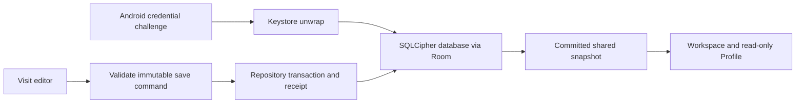

# ANC native Android — P2 storage proposal

Date: 2026-10-09; compatibility scope amended 2026-10-10 (Africa/Cairo). Status: **OWNER ACCEPTED / HONOR400 COMPATIBILITY AMENDMENT PREPARED — current build, API36 security, lifecycle, instrumentation, and layout gates pending**.

Project: `/Users/sherifgamalradwan/anc-emr-android-native`; package `com.sherifradwan.ancnative`, application ID `com.sherifradwan.ancnative.dev`. P1 code/config hashes match its verified record. P1 APK SHA-256: `2d05817f6ad99658c48f6b1bf33d15d8250d2d7903a3a0832f79c205b13264c5`.

## Owner acceptance record

The Owner explicitly said **“start now”** after being asked to approve the listed dependency/plugin additions, initial synthetic database schema1, Android credential unlock with the required normal USE_BIOMETRIC permission, and the device-bound synthetic limitation. The current execution instruction reconfirmed that no further approval is needed for this exact plan. This records that acceptance only; it is not build, security, emulator, clinical, or release acceptance.

No backup/recovery/export/reset is implemented here; permanent key or device loss makes its synthetic records inaccessible. Saved visits persist, unsaved drafts do not survive lock/process death. Foreground sessions end on background/manual Lock; this slice does not add inactivity timeout or biometric unlock.

Implementation is limited to this reviewed contract. Clinical data, existing-record import, release signing and physical-device installation are excluded.

### Superseding HONOR400 compatibility scope — 2026-10-10

The Owner withdrew the former broad API26/API36 version matrix and approved one exact API36 engineering target, with `minSdk` raised from 26 to 35 and compile/target 36 unchanged. All dependencies, delivery version, signing, clinical logic, schema, credential/security/data assertions, canonical-vault protections, failure-injection checks, and historical evidence remain unchanged. The old API26 results are historical only and cannot qualify a new build.

Designated OpenCode remained definitively unavailable: `opencode models deepseek` exited 1 with `Provider not found: deepseek`. A fresh independent read-only AGY review returned **PASS** at **[Codex Reasoning Level: xhigh]** for this bounded amendment: project `d825f981-f84d-4468-b2aa-57345e74c8fe`, conversation `a33a5854-300a-41c5-9b81-f317dbc754ce`.

Read-only device observation found the Owner's HONOR400 as DNY-NX9, Android 16 / API36, `arm64-v8a`, 4096-byte page size, with the native package absent. This is environment observation only: no installation or phone validation has occurred, the phone is not a disposable emulator, and physical preflight/installation is a separate bounded task. P2 acceptance is not granted.

Fallback header: designated OpenCode1.18.30 planner check exited 1 with `Provider not found: deepseek` on 2026-10-09. This is a Codex-authored fallback plan, not permission to implement. Independent AGY PASS and explicit owner approval of new dependencies/schema are required first.

## Objective

Convert an existing synthetic Kotlin/Compose in-memory patient/visit prototype into a device-local encrypted persistence prototype. After explicit initialization and Android credential unlock, a saved synthetic visit must survive process death and appear consistently in Workspace and read-only Profile. Preserve unknown/blank values and all existing patient-isolation, revision and dirty-navigation protections. No real patient use or production acceptance.

## Exact paths and bindings

All paths below are relative to the native project root. The independent reviewer receives the same parameterized proposal with public placeholders for root/package and no private source or repository access. Local bindings are expanded below; no recursive globs are permitted.

Modify:
- `build.gradle.kts`, `app/build.gradle.kts`, `app/src/main/AndroidManifest.xml`
- `app/src/main/java/com/sherifradwan/ancnative/MainActivity.kt`, `app/src/main/java/com/sherifradwan/ancnative/state/AncState.kt`, `app/src/main/java/com/sherifradwan/ancnative/state/AncViewModel.kt`
- `app/src/main/java/com/sherifradwan/ancnative/ui/AncApp.kt`, `app/src/main/java/com/sherifradwan/ancnative/ui/VisitEditor.kt`
- `app/src/main/res/values/strings.xml`, `app/src/main/res/values-ar/strings.xml`
- `app/src/test/java/com/sherifradwan/ancnative/state/AncStateTest.kt`, `app/src/androidTest/java/com/sherifradwan/ancnative/AncWorkflowTest.kt`, `README.md`

Add:
- `app/src/main/java/com/sherifradwan/ancnative/storage/VaultState.kt`, `app/src/main/java/com/sherifradwan/ancnative/storage/VaultFiles.kt`, `app/src/main/java/com/sherifradwan/ancnative/storage/AndroidVaultKeys.kt`, `app/src/main/java/com/sherifradwan/ancnative/storage/VaultController.kt`
- `app/src/main/java/com/sherifradwan/ancnative/storage/RecordsDatabase.kt`, `app/src/main/java/com/sherifradwan/ancnative/storage/RecordEntities.kt`, `app/src/main/java/com/sherifradwan/ancnative/storage/RecordsDao.kt`, `app/src/main/java/com/sherifradwan/ancnative/storage/RecordsRepository.kt`
- `app/src/main/java/com/sherifradwan/ancnative/storage/SaveVisitCommand.kt`, `app/src/main/java/com/sherifradwan/ancnative/ui/VaultGateScreen.kt`
- `app/src/test/java/com/sherifradwan/ancnative/storage/VaultStateTest.kt`, `app/src/test/java/com/sherifradwan/ancnative/storage/SaveCoordinatorTest.kt`
- `app/src/androidTest/java/com/sherifradwan/ancnative/storage/VaultIntegrationTest.kt`, `app/src/androidTest/java/com/sherifradwan/ancnative/storage/EncryptedRecordsTest.kt`
- `app/schemas/com.sherifradwan.ancnative.storage.RecordsDatabase/1.json`
- `tools/verify_p2.py`, `docs/P2_STORAGE_PLAN.md`, `docs/P2_VALIDATION.md`

Read-only reference paths: existing model/fixtures, Debug manifest and backup/extraction rules, existing P1 validation. Generated Gradle/KSP outputs and `evidence/p2/` are allowed; no other source path, manifest change beyond declaring the normal USE_BIOMETRIC permission required by platform credential prompt, new permission, branch, commit, or deployment. If a necessary path lies outside this list, amend and re-review before editing.

## Approved dependency budget

Use the amended minSdk35 with target/compile36; keep JDK17, AGP8.13.2, Gradle8.13, Kotlin/Compose2.2.21, Compose/activity/lifecycle/test baseline, every dependency, and signing unchanged. Delivery versionCode2/versionName0.2-p2; the P1 artifact and exact source/config baseline are preserved under `evidence/p2/baseline/` and must not be overwritten.
- KSP plugin `com.google.devtools.ksp:2.2.21-2.0.5`, use KSP2.
- `androidx.room:room-runtime:2.8.5`, `androidx.room:room-ktx:2.8.5`, KSP `androidx.room:room-compiler:2.8.5`.
- `net.zetetic:sqlcipher-android:4.19.1@aar` Community Edition plus `androidx.sqlite:sqlite:2.7.0`.
- No other direct dependency, alpha library, dependency substitution or baseline toolchain upgrade. Ordinary transitive dependencies must be recorded in resolved dependency evidence. First implementation gate is compatibility assembly; incompatibility stops for amendment, not an improvised version upgrade.

Sources checked 2026-10-09: Android Room release documentation lists 2.8.5 stable; SQLCipher upstream documents 4.19.1, API23+, and Room2 SupportOpenHelperFactory integration; Google KSP publishes the Kotlin2.2.21-aligned tag. The pinned compatibility assembly completed successfully in `evidence/p2/compatibility-online.log`; this is not vulnerability certification or runtime acceptance.

## Architecture and schema v1

Room2 over the current SQLCipher `SupportOpenHelperFactory`, never platform unencrypted SQLite or the deprecated SQLCipher Android library. Load the bundled native library before use. Database handles are per unlocked session, not a global Room instance: after lock, close and null the database and DAO references, and on next successful unlock construct a fresh Room instance/factory. Do not invoke DAOs from a closed instance. All database, WAL/journal and key-envelope files reside under an app-private `noBackupFilesDir` vault directory; schema JSON contains structure only. Keep backup/cloud/D2D exclusions and no network/storage permission.

Four tables: patients (stable id primary key, unique synthetic case id, display name and nullable existing demographics), visits (stable id primary key, indexed patient FK RESTRICT, recorded date and existing nullable fields, positive revision and synthetic flag), vault_metadata (vault UUID, schema1, synthetic flag, initialized marker), save_receipts (operation UUID primary key, patient/visit ids, committed revision and canonical-command fingerprint). No clinical inference, new patient creation/deletion, migration from P1, or destructive migration fallback. P1 had no persisted data. Persist only the existing three synthetic fixtures once, upon explicit Initialize demo storage, within the first DB transaction. Never reseed on ordinary launch, read failure or an empty query. No schema2/migration implementation in P2. The implementation schema must preserve precisely the existing nullable domain fields: patients id/caseId/displayName/dateOfBirth?/phone? and visits id/patientId/date/bloodPressure?/weight?/findings?/notes?/revision/isSyntheticEdit. Metadata stores only schema/vault/synthetic-initialization state; receipts store only operation/patient/visit/revision/fingerprint. No clinical columns, identifiers or defaults beyond those listed. The positive-revision/synthetic constraints are validated in repository transactions; DB keys, indexes and foreign keys are exported by Room for review.

Repository operations execute on an IO dispatcher and serialize with one application-process vault controller/lease (application context only, never an Activity singleton), shared by all activity-scoped ViewModels. No multiple-process service/components are introduced. Concurrent activity instances cannot provision separate vaults or race writes; tests cover this shared-controller boundary. Consistent multi-query read transactions return complete patient-plus-visits snapshots to the same authority feeding Workspace and Profile; existing domain objects may be mapped, without changing clinical field semantics.

## Key and provisioning lifecycle

Generate a random 32-byte SQLCipher passphrase using SecureRandom. It is not a user PIN and is never converted to String, logged, hardcoded or stored plaintext. Wrap it with a non-exportable AndroidKeyStore AES256/GCM/NoPadding key requiring recent OS authentication. Let the Cipher generate a fresh IV for each wrap; validate a versioned bounded envelope containing vault UUID, alias id, algorithm id, IV and authenticated ciphertext/tag. Bind format version + vault UUID through AAD. Persist only this envelope with AtomicFile. Hardware backing is measured if available, never promised; no forced StrongBox or silent unprotected key fallback. Room construction is lazy: Room.build() alone is not an opened database. Keep the factory-owned passphrase bytes valid until the encrypted connection is explicitly forced open through openHelper.writableDatabase and schema/key validation succeeds. Never wipe an array passed by reference before SQLCipher keying. Clear temporary owned copies in finally after that point, and account explicitly for any factory/connection-owned copy required during the active session; wipe/release those at session closure only when no connection can reopen from them. Disable Room auto-close for this slice; use a fresh factory/database on each new unlocked session. Inspect the pinned factory implementation before fixing byte-array ownership; if it retains the reference, do not assume clearing caller bytes leaves future connections unaffected. A reopen+WAL/new-connection test must verify the chosen lifetime. No plaintext String key.  close/release library handles on lock and accurately document JVM/native-memory erasure limits.

Use one per-vault wrapping alias, generated only during explicit clean initialization. Existing active storage must use get-existing-key, never get-or-create. Removing/replacing a missing/invalid key or regenerating it on read failure is forbidden.

Provisioning is explicit and ordered: detect truly empty storage; create a vault UUID directory and bounded non-sensitive descriptor; generate wrapping alias, complete the explicit OS credential challenge, then use that authorization to wrap the passphrase in ENCRYPT_MODE and persist the envelope; explicitly force the encrypted connection open and validate key/schema, then seed in one transaction; close it successfully; atomically publish the active-vault pointer last. Detect any prior directory, pointer backup/temp file, or matching orphan alias before offering initialization. A crash in these stages produces Incomplete setup with artifacts preserved. No automatic overwrite, delete, reset, reseed, or multi-file atomicity claim. Current phase offers no reset button or resume/recovery algorithm. Tests inject interruption at every stage.

## Unlock, lock and recovery behavior

Recommend Android device credential authentication; no app-owned PIN, biometrics-only requirement or custom password hashing. Require KeyguardManager.isDeviceSecure. API26-29 uses createConfirmDeviceCredentialIntent through Activity Result (document the bounded deprecated compatibility path). API30+ uses platform BiometricPrompt with DEVICE_CREDENTIAL only; omit setNegativeButton entirely when DEVICE_CREDENTIAL is allowed. On API30+ also require BiometricManager.canAuthenticate(DEVICE_CREDENTIAL) == BIOMETRIC_SUCCESS before prompting. No AndroidX biometric dependency. Declare only the required normal android.permission.USE_BIOMETRIC (no network/storage permission); no runtime permission dialog. Key authorization uses a short positive validity window (30 seconds) via API-appropriate KeyGenParameterSpec, with AUTH_DEVICE_CREDENTIAL on API30+. Access opens only after both an explicit matching successful OS challenge and an actual successful envelope decrypt in the current foreground session. The 30-second key-authorization duration governs wrapping/unwrapping, not session duration; this bounded prototype stays unlocked while foregrounded until manual lock/background. No inactivity auto-lock is claimed in P2. OS-key authorization caching alone must never automatically unlock the app. Check device credential support and timeout/cancel/errors; no insecure fallback.

Vault state machine: Uninitialized / Authenticating / Locked / Opening / Unlocked / Closing / Blocked, with typed error reasons. While locked/opening/blocked no patient data or draft is rendered. Cancellation semantics are phase-specific: cancellation, OS error, configuration detach, or app-background interruption during first INITIALIZE after artifacts begin preserves every artifact and becomes Blocked(INCOMPLETE_SETUP), with no Unlock/resume/reset affordance; the same events during an existing-vault UNLOCK invalidate that request and return Locked for a fresh explicit retry. Initialization preflight without a configured credential writes no artifact. Manual Lock immediately hides and releases all patient/draft/query state and invalidates outstanding auth/save/read callbacks. Ordinary app background locks; activity recreation for rotation preserves the foreground session. During the OS credential overlay the app remains locked; lifecycle callbacks must not accidentally open it or cancel all legitimate authentication. Controller uses monotonic session/request epochs, validates actual resumed/foreground state and explicitly rejects obsolete results. A returned OS success is insufficient if its request was cancelled, superseded or followed by a manual/background lock; callbacks never manufacture foreground, and a legitimate success may be deferred only until resumed delivery. No patient/key bytes are exposed while backgrounded. For platform prompt rotation, cancel the old Activity CancellationSignal on teardown and invalidate its callback epoch; INITIALIZE becomes Blocked(INCOMPLETE_SETUP), while UNLOCK returns Locked and does not auto-prompt. P2 preserves drafts on rotation only within an already unlocked foreground session; rotating during a locked authentication challenge cannot create a draft. ActivityResult registration for API26-29 is keyed and exactly-once; old/superseded results do not open storage. This deliberate bounded behavior avoids retaining Activity references or adding AndroidX biometric/fragment dependencies. Detailed lifecycle transition tests are mandatory.

A background/lock during a save may occur before or after the DB commit. Hide data immediately, serialize handle closure with in-flight work, reject stale UI emissions, and report only what is known. Closing waits for the serialized in-flight operation; it must not call close while a transaction still owns the lease. If draining exceeds a 2000ms reporting deadline, keep UI locked, enter Closing/blocked-busy, retain ownership of the handle, forbid reopening, and close only after the worker releases it. Never force-close the DB, release its key storage prematurely, claim rollback on timeout, or launch a competing handle. Epoch invalidation/UI hiding occur immediately and outside the IO mutex; the mutex protects storage/close, not UI responsiveness. Do not promise cancellation reverses a committed transaction. An acknowledged save survives restart; an interrupted unacknowledged save may be present or absent, never partial/duplicated. Unsaved drafts remain in memory and are discarded on lock/process death; display this policy before initialization and in editor copy. No Bundles/SavedStateHandle/rememberSaveable clinical state.

No device lock configured: blocked explanation, no DB/key created. Missing key, missing envelope/DB/pointer, invalid GCM tag, wrong key, unknown format/schema, failed integrity check or corruption: typed Blocked state (including a distinct KEY_PERMANENTLY_INVALIDATED category), preserve ciphertext/metadata and stop. Retry only reattempts safe opening; never creates a replacement. Do not log raw exceptions carrying SQL/data/key paths or contents; diagnostics use bounded category codes. Disable SQLCipher Java client logging, never enable SQL trace or provider debug key logs.

This P2 implementation is explicitly device-bound and synthetic: no export, cloud backup, credential-independent recovery, key rotation, sync, import or destructive reset. Device loss/uninstall/permanent key invalidation cannot recover records in this phase. The Owner accepted that limit for synthetic testing. Production/recovery needs a separate reviewed slice before real patient use. The app must not advertise recovery or compliance.

## Transactional save contract

Replace the existing optimistic in-memory Save success with a pure prepare/validate command plus asynchronous repository commit. Freeze patient id, visit id, expected revision, normalized recorded fields, operation UUID and command fingerprint for one submission. Disable editing/save/cancel/navigation that would mutate the pending command while commit is unresolved; lock/background always permitted. No saved notice, navigation or authoritative patient mutation until durable commit/readback succeeds. Confirmed failure retains the draft and shows an error; ambiguous I/O outcome enters explicit unresolved-save state, reconciles receipts before further editing/retry, never falsely reports not saved.

Updates use patient + visit + expected revision predicates; affected-row count must be exactly1. Inserts reject conflicting ids. Save receipt and row update are in one DB transaction; retry of the same operation UUID and identical command returns its existing receipt, changed payload under that UUID is rejected. Stale revisions, cross-patient writes and invalid dates fail before authority changes. Repository reads committed state back; late results must match active session/editor token. Existing dirty Back confirmation, Profile read-only behavior and blank-as-unknown rules remain.

## Acceptance and harness

1. Focused tests retain the P1 behavioral assertions and add storage/session tests; no lint suppression or weakened tests. The amended root host gate is `./gradlew --offline :app:testDebugUnitTest :app:lintDebug :app:assembleDebug :app:assembleDebugAndroidTest --console=plain`. Fetch only owner-approved pins from official repositories if cache gaps exist. Compiler schema JSON1 must match the proposed tables, keys and nullability; schema hash recorded.
2. On one explicitly disposable synthetic API36 emulator: no credential configured blocks creation; real OS credential challenge success/cancel; save->Workspace->Profile; true HOME/am-kill/reopen/unlock preserves acknowledged saved rows; unsaved draft resets; rotation; background/manual lock; late auth/read/save/open callbacks; duplicate-submit/retry; stale revisions; cross-patient writes; empty read does not seed; DB/metadata mismatches and corruption fail closed. New isolated vaults for failure injection: VaultFiles/AndroidVaultKeys accept internal test-injected base directory and alias prefix, defaulting to canonical app-private values. Each instrumentation case gets a UUID test namespace and its own pointer; production MainActivity cannot override these via Intent, URI, network, preference or exported API. Tests delete only their registered namespace/alias in finally (or record leftovers after a kill); the runner never clears the user app vault. Scope remains in the two approved test files and controller abstractions, with no production reset endpoint. Never damage existing records/devices. A failure to provision exact API36 or an actual OS challenge is UNKNOWN/HARNESS ERROR, not a skipped PASS. The verifier rejects API26 and all other API levels before install or UI mutation and never treats a physical phone as a disposable emulator.
3. Failure injection proves interrupted provisioning artifacts preserved; failed/unresolved saves and forced process death yield old-or-new complete transactions with receipts, not partial writes or duplicate rows. Missing wrapping alias and damaged envelopes never cause alias/DB replacement or fixture fallback. Scan vault DB/WAL/journal and wrapper for unique synthetic sentinel strings and verify stock SQLite cannot read them; these checks support at-rest proof but are not a comprehensive security certification. Compare protected file hashes across failure cases where opening should have been refused before DB access.
4. Small phone, large font, landscape, tablet, dark and Arabic/RTL checks cover new initialization/locked/error/save-pending surfaces, accessible controls and synthetic banner. Capture native UI and logs; no patient leakage while locked/recents. Enable FLAG_SECURE on records/unlocked surfaces (MainActivity) and check normal screenshots/recents protection. Visual proof of sensitive surfaces may use emulator-owned instrumentation pixel capture only if it does not disable FLAG_SECURE; if unavailable report gap rather than modifying security for proof.
5. Inspect final compiled manifest after new libraries because existing debug removeAll receivers can affect transitive registrations. Only launcher exported, zero unwanted receivers, no network/storage permissions, backups excluded, profile startup behavior considered. Inspect bundled native libraries/ZIP alignment for16KB compatibility; do not equate binary alignment with a16KB-runtime pass. If the16KB emulator is unavailable label runtime proof UNKNOWN separately. Verify debug APK signature/hash, dependency tree, schema hash and exact-path diff; preserve P1 APK/verification and original reference repos. `python3 tools/verify_p2.py --serial <disposable-serial> --expected-avd <exact-disposable-avd-name> --apk app/build/outputs/apk/debug/app-debug.apk` first verifies the selected serial, qemu property, and exact AVD identity, then orchestrates true HOME -> `am kill` -> absent PID -> new PID process recreation, ciphertext/export/manifest checks, and saves `evidence/p2/verification.json` with exact environment and UNKNOWN distinctions. `force-stop` is not process-recreation proof.

All mandatory crypto/data/lifecycle/OS-unlock, instrumentation, current app/test APK hash attribution, and accessible-layout gates must pass on the exact API36 engineering target before P2 engineering PASS. Historical API26 evidence cannot qualify the current build. Optional16KB-runtime and protected-pixel visual limitations are separately reported and do not confer release acceptance.

Stop after approved P2 acceptance, or halt for any unreconciled crypto/data-integrity issue. No Git commit/push, release signing, physical-device install, real clinical data, clinical arithmetic or P3 feature expansion.

Primary public references:
- https://developer.android.com/jetpack/androidx/releases/room?hl=en
- https://github.com/sqlcipher/sqlcipher-android
- https://github.com/google/ksp/releases/tag/2.2.21-2.0.5
- https://developer.android.com/privacy-and-security/keystore
- https://developer.android.com/identity/sign-in/biometric-auth
- https://developer.android.com/reference/android/app/KeyguardManager

- https://developer.android.com/reference/kotlin/android/hardware/biometrics/BiometricPrompt
- https://developer.android.com/reference/kotlin/android/security/keystore/KeyGenParameterSpec.Builder

## Final review receipt

Fresh read-only AGY1.3.2 consultation returned **PASS** and **[Codex Reasoning Level: xhigh]** on 2026-10-09. Project `e72a5451-e1de-4fcb-b6e5-30fbb02887ff`, conversation `b98a29b4-1964-4f1c-99df-06af8666e3e0`. Earlier independent review returned AMEND; the submitted revision addresses its required changes. Both were fresh isolated sessions with an empty workspace and no private repository/source access.

The public parameterized proposal SHA-256 is `40b2e86fbf8395404b8af31978ad16803802282104da0193dbf118f664ce78ab`. Its submitted bytes match the archived relay brief. This local document expands root/package bindings and records the result; it does not expand implementation scope.

The Owner subsequently accepted the dependency pins, initial schema1 definitions, and synthetic device-bound recovery limitation and authorized this exact implementation. Source and deterministic harnesses are now prepared only in the listed paths. The compatibility assembly passed before source implementation. At that time the compiler-exported schema/hash, full Gradle gates, API26/API36 real-credential runs, ciphertext inspection, and artifact checks remained external execution gates. This historical matrix statement is superseded by the dated HONOR400 amendment above; no clinical, security-certification, production, signing, phone, or release acceptance is granted.

The phase-specific initialization-cancellation clarification received a separate fresh read-only AGY PASS at **[Codex Reasoning Level: xhigh]**: project `687f2174-4642-41c7-95ac-26d52de791c0`, conversation `a6f5a8eb-8a09-4b6b-9136-c7b16b0a64ff`. The reviewed brief and response are preserved in `evidence/p2/reviews/initial-cancel-proposal.md` and `evidence/p2/reviews/initial-cancel-agy.md`. This clarification adds no recovery, reset, dependency, schema, or cold-start resume path.

Historical verification completed 15 unit tests and 21 instrumentation tests on each of API26 and API36 against APK SHA-256 `6a28093424cc025ebb330f5cc4ea9fbd21e3e8207607ed7e0844e551aed15cf0`. Those reports remain preserved as historical evidence and do not validate any APK built after the 2026-10-10 compatibility amendment.

See [P2 validation and execution status](P2_VALIDATION.md).
