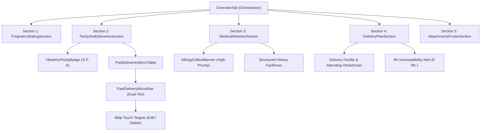

# Technical Design: Patient Workspace Overview Tab Optimization

* **Author:** sherifrad
* **Date:** 2026-11-09
* **Status:** PROPOSED

---

## 1. Problem Statement & Background

### 1.1 The Clinical Problem
In the native Android Antenatal Care EMR (`anc-emr-android-native`), the Patient Workspace `OverviewTab` acts as the primary landing surface when opening a maternal health chart. Currently, this screen stacks six heavy, independent vertical cards directly below the persistent `PatientHubHeader`:
1. `GestationalDatingCard` (~180dp height)
2. `ObstetricParityCard` (~140dp height)
3. `MedicalHistoriesCard` (~220dp height)
4. Prior Pregnancies timeline (`PreviousPregnancyCard` × N deliveries; ~120dp per child)
5. `DeliveryPlanningCard` (~260dp height)
6. `AttachmentsSectionCard` (~160dp height)

On standard 360dp narrow mobile viewports, this architecture introduces severe clinical and usability defects:
* **Information Duplication**: The persistent `PatientHubHeader` already displays real-time Gestational Age (`GA: 38w 3d`), EDD, Maternal Age, Gravida/Parity (`G2 P1`), Blood Group (`O+`), Allergies, and Clinical Attention flags. Stacking full Dating and Parity cards immediately below repeats these exact same metrics, consuming ~320dp of vertical viewport before novel clinical history appears.
* **Prior Pregnancies Vertical Bloat**: For multiparous patients (e.g., G4 P3 A0), each past pregnancy is rendered in its own bordered card with full headers, borders, and dividers. This pushes subsequent clinical domains (such as planned Cesarean section details and attached laboratory PDFs) down beyond 1,200dp of scrolling.
* **Card Fatigue & Visual Noise**: Six floating cards, each with distinct border strokes, tinted backgrounds, and separate elevations, fragment the clinical reading flow. Clinicians must visually parse multiple container boundaries rather than scanning a cohesive medical record.

---

## 2. Overview

This design replaces the 6-card floating stack with a single calm, unified grouped canvas organized into four primary clinical domain sections separated by subtle semantic hairline dividers, plus a compact document gallery footer:
1. **Pregnancy Dating & Authoritative Due Date**: Eliminates redundant hero GA badges; presents authoritative Estimated Due Date (EDD), calculation method pill, and clinician dating notes.
2. **Obstetric Parity & Past Deliveries Timeline**: Unifies obstetric parity metrics (`G P A`) with a dual-tier, monospaced micro-tabular past delivery list (`Year · Mode · Outcome` / `GA · Weight · Doctor`), shrinking past delivery height from ~540dp to ~120dp on 360dp screens.
3. **Medical, Surgical & Family Histories**: Features an unmissable high-contrast drug allergy callout container (`MaterialTheme.colorScheme.errorContainer`) at the section top, followed by structured medical, surgical, and family background summaries.
4. **Delivery & Postpartum Management Plan**: Synthesizes planned delivery facility, attending clinician, intended delivery mode, and postpartum care strategy.
5. **Documents & Attachments**: Preserves attached clinical scans and lab records as a clean thumbnail gallery at the canvas footer.

---

## 3. Goals and Non-Goals

### 3.1 In-Scope Goals
* **Unified Grouped Canvas**: Replace floating cards with a single continuous surface using standardized `ClinicalGroupSection` containers, domain-tinted 24dp icon capsules, and 0.75dp hairline dividers.
* **Header De-duplication**: Strip out redundant Gestational Age calculations from the Overview tab body, reserving real-time GA strictly for the persistent header.
* **Dual-Tier Past Deliveries Timeline**: Render prior pregnancies in a high-density, 40dp-height two-tier micro-row with monospaced tabular figures, ensuring zero horizontal text clipping on 360dp viewports.
* **Non-Destructive Biometric Extraction**: Extract GA at delivery and birth weight safely from existing free-text fields (`otherDetails` and `outcomeText`) with clean `—` fallback, strictly preserving frozen Room database schema v6 without migrations.
* **SAMD Safety & Touch Target Invariant**: Enforce strict $\ge 48\,\text{dp}$ touch bounding boxes for all interactive edit, delete, and add affordances.

### 3.2 Non-Goals (Out of Scope)
* **Zero SQLite Migrations**: Room database schema v6 is 100% frozen; zero new columns or tables will be added to `AncDatabase`.
* **Zero Cross-Tab Ingestion**: Overview remains scoped to maternal background, dating authority, parity, past deliveries, and plan snapshot; Visits, Scans, Labs, and Medications retain their dedicated tabs.
* **No Backward-Compatibility Overhead**: No legacy shims or dead composables maintained (Rule 3: Zero Legacy Baggage).

---

## 4. Technical Architecture & Component Hierarchy

### 4.1 Component Architecture
To enforce the **Rule of Reusability** and eliminate card fatigue, the UI is decomposed into modular composables under `ui/patienthub/components/`:



### 4.2 Standardized Container: `ClinicalGroupSection`
All four sections are housed inside a canonical section container that replaces floating elevated cards with calm semantic separation:

```kotlin
@Composable
fun ClinicalGroupSection(
    title: String,
    icon: ImageVector,
    iconTint: Color,
    iconBgColor: Color,
    actionButton: @Composable (() -> Unit)? = null,
    modifier: Modifier = Modifier,
    content: @Composable ColumnScope.() -> Unit,
) {
    Column(
        modifier = modifier
            .fillMaxWidth()
            .padding(vertical = 8.dp),
        verticalArrangement = Arrangement.spacedBy(8.dp),
    ) {
        Row(
            modifier = Modifier.fillMaxWidth(),
            verticalAlignment = Alignment.CenterVertically,
            horizontalArrangement = Arrangement.SpaceBetween,
        ) {
            Row(
                verticalAlignment = Alignment.CenterVertically,
                horizontalArrangement = Arrangement.spacedBy(8.dp),
            ) {
                Box(
                    modifier = Modifier
                        .size(24.dp)
                        .background(iconBgColor, RoundedCornerShape(6.dp)),
                    contentAlignment = Alignment.Center,
                ) {
                    Icon(
                        icon,
                        contentDescription = null,
                        tint = iconTint,
                        modifier = Modifier.size(15.dp),
                    )
                }
                Text(
                    text = title,
                    style = MaterialTheme.typography.titleMedium,
                    fontWeight = FontWeight.Bold,
                    color = MaterialTheme.colorScheme.onSurface,
                )
            }
            actionButton?.invoke()
        }

        HorizontalDivider(
            color = MaterialTheme.colorScheme.outlineVariant.copy(alpha = 0.35f),
            thickness = 0.75.dp,
            modifier = Modifier.padding(bottom = 4.dp),
        )

        content()
    }
}
```

### 4.3 Dual-Tier Past Delivery Micro-Row (`PastDeliveryMicroRow`)
To resolve the contradiction between displaying five data points and fitting inside 328dp usable width:

* **Dimensions**: 40dp content height, expanded to 48dp minimum touch target with `Modifier.minimumTouchTarget()`.
* **Visual Rhythm**:
  * **Line 1 (Authoritative Milestones)**:
    - `Year`: Monospaced badge (e.g., `2021`).
    - `Outcome`: Status chip (e.g. `Live Birth` in calm green, `Early Loss` in muted rose).
    - `Mode`: Bold label (e.g., `Cesarean Section (CS)` or `Spontaneous Vaginal (SVD)`).
    - Trailing edit/delete action row.
  * **Line 2 (Clinical Biometrics & Context)**:
    - Gestational age: `GA 39w 2d` (or `—` fallback).
    - Birth weight: `3,450g` (or `—` fallback).
    - Place/Attending Doctor: `St. Mary's Hospital · Dr. Smith`.

### 4.4 Non-Destructive Biometric Parsing
Since schema v6 has no dedicated columns, a zero-cost utility safely extracts metrics from `otherDetails` and `outcomeText`:

```kotlin
data class ParsedDeliveryBiometrics(
    val gaText: String?,
    val weightText: String?,
)

fun extractDeliveryBiometrics(otherDetails: String?, outcomeText: String?): ParsedDeliveryBiometrics {
    val combined = "${otherDetails.orEmpty()} ${outcomeText.orEmpty()}"
    val gaMatch = Regex("""\b(\d{1,2}(?:\+\d)?\s*(?:w|wks|weeks?))\b""", RegexOption.IGNORE_CASE).find(combined)?.groupValues?.get(1)
    val weightMatch = Regex("""\b(\d(?:\.\d{1,2})?\s*(?:kg|kilos?)|[1-5]\d{3}\s*g(?:rams?)?)\b""", RegexOption.IGNORE_CASE).find(combined)?.groupValues?.get(1)
    return ParsedDeliveryBiometrics(
        gaText = gaMatch,
        weightText = weightMatch,
    )
}
```

### 4.5 Section Breakdown & Data Mapping

1. **Pregnancy Dating Section**:
   - `agreedEdd ?: ultrasoundEdd ?: calculateEstimatedDueDate()`
   - Method tag: `datingMethod` (Ultrasound, LMP, IVF)
   - Underlying parameters: LMP date, IVF transfer date / embryo age
   - Readable paragraph text: `dating.notes`
2. **Parity & Past Deliveries Section**:
   - `ObstetricParityBadge(g = patient.gravida, p = patient.parity, a = patient.abortion)`
   - Nulliparous guard: If `previousPregnancies.isEmpty()`, display *"Primigravida · No prior deliveries recorded"*.
   - Timeline: `items(patient.previousPregnancies)` rendered via `PastDeliveryMicroRow`.
   - Notes: `patient.obstetricNotes` rendered via `FactRow` at section bottom.
3. **Medical Histories Section**:
   - Allergy Alert: If `!patient.allergyHistory.isNullOrBlank()`, renders high-contrast warning banner at the top of the section; otherwise displays calm *"No Known Drug Allergies (NKDA)"*.
   - Medical History (`patient.medicalHistory`).
   - Surgical History (`patient.surgicalHistory`).
   - Family History (`patient.familyHistory`).
4. **Delivery & Postpartum Plan Section**:
   - Planned Facility (`parsed.hospital`).
   - Attending Clinician (`parsed.doctor`).
   - Intended Mode (`parsed.deliveryPlan`).
   - Rh Incompatibility Warning: Elevated warning if `isRhNegative(patient.bloodGroup)`.
   - Postpartum & Contraception notes.
5. **Documents & Attachments Section**:
   - Clean, compact horizontal preview strip using existing `AttachmentsSectionCard` logic, avoiding vertical card bloat.

---

## 5. Alternatives Considered

| Alternative | Evaluation | Technical & Clinical Rationale |
| :--- | :--- | :--- |
| **Keep Floating Cards with Reduced Padding** | **Rejected by author** | Retaining individual bordered cards with adjusted padding fails to eliminate card fatigue and visual noise; container borders, separate background surfaces, and elevations consume ~96dp of useless vertical padding on mobile screens. |
| **Strict 5-Column Single-Line Grid Table** | **Rejected by author** | Attempting to force `Year | Mode | Outcome | GA | Birth Weight` into a single horizontal row requires ~440dp width. On 360dp mobile viewports (usable width: 328dp), column text suffers critical truncation into unreadable abbreviations (`Liv...`, `Vag...`) or requires clunky horizontal scrolling. |
| **Collapsible / Accordion Past Deliveries** | **Rejected by author** | Hiding prior pregnancies behind an expand/collapse toggle violates SAMD clinical safety principles by concealing uterine scar history (e.g., prior Cesarean sections) and previous severe obstetric complications behind required clicks. |
| **Adding Dedicated Database Columns for GA & Birth Weight** | **Rejected by author** | Violates the frozen Room database schema v6 constitutional rule. Altering entity tables would trigger SQLite schema migrations and hash invalidation without clinical regulatory sign-off. Regex extraction from existing free-text fields achieves the same visual outcome with zero migration overhead. |
| **Unbounded Canvas without Section Headers or Dividers** | **Rejected by author** | Removing all visual boundaries and rendering a continuous stream of text causes distinct clinical domains (Dating, Parity, Histories, Plan) to blur together into an un-scannable wall of text. Standardized `ClinicalGroupSection` containers with domain-tinted icon capsules and 0.75dp hairline dividers provide necessary visual scaffolding. |

---

## 6. Detailed Implementation Plan

### 6.1 Single Unified Execution List
1. **Model Layer**:
   - Add `ParsedDeliveryBiometrics` and `extractDeliveryBiometrics(otherDetails, outcomeText)` in `model/ClinicalModels.kt`.
   - Add unit tests in `test/java/com/sherifradwan/ancnative/model/DeliveryBiometricsParsingTest.kt` verifying pattern extraction (`39w`, `3.4kg`, `3400g`) and fallbacks.
2. **Design System & Components**:
   - Create `ui/patienthub/components/ClinicalGroupSection.kt`: canonical section container with 24dp domain capsule, title, action slot, hairline divider, and content.
   - Create `ui/patienthub/components/PastDeliveryMicroRow.kt`: dual-tier past delivery micro-row with monospaced Year badge, Outcome status chip, Mode text, biometrics secondary row, and 48dp touch targets.
   - Create `ui/patienthub/components/OverviewSections.kt`: modular section implementations for `PregnancyDatingSection`, `ParityAndDeliveriesSection`, `MedicalHistoriesSection`, and `DeliveryPlanSection`.
3. **Screen Orchestrator Refactor**:
   - Refactor `ui/patienthub/tabs/OverviewTab.kt`: replace the 6-card vertical stack with the unified grouped canvas using the modular sections. Keep file size under 180 lines (Rule 2: Anti-Spaghetti Invariant).
   - Retain legacy test tags (`datingCard`, `obstetricParityCard`, `medicalHistoriesCard`, `deliveryPlanningCard`, `editDating`, `addPregnancyButton`) directly on section containers to preserve 100% test suite compatibility.
4. **Strings & Localization**:
   - Add string resources in `res/values/strings.xml` for `primigravida_no_prior_deliveries`, `past_deliveries_title`, `delivery_mode_label`, `birth_weight_label`.
5. **Verification & Delivery**:
   - Run full unit test suite `./gradlew testDebugUnitTest`.
   - Build debug APK with `./gradlew assembleDebug`.
   - Install on physical device (Honor DNY-NX9) via ADB.
   - Capture live screenshots of multiparous (Maya) and nulliparous (Elena) charts to verify dual-tier layout, zero horizontal truncation, and clean visual rhythm.

### 6.2 Enumerated Files Touched

| File Path | Action | Rationale |
| :--- | :--- | :--- |
| [`app/src/main/java/com/sherifradwan/ancnative/model/ClinicalModels.kt`](file:///Users/sherifgamalradwan/anc-emr-android-native/app/src/main/java/com/sherifradwan/ancnative/model/ClinicalModels.kt) | **MODIFIED** | Add non-destructive `extractDeliveryBiometrics` helper to safely parse GA and weight from existing free-text fields without Room schema v6 changes. |
| [`app/src/test/java/com/sherifradwan/ancnative/model/DeliveryBiometricsParsingTest.kt`](file:///Users/sherifgamalradwan/anc-emr-android-native/app/src/test/java/com/sherifradwan/ancnative/model/DeliveryBiometricsParsingTest.kt) | **CREATED** | Unit tests verifying regex extraction across various clinical input notations (`39w 2d`, `3.5kg`, `3500g`, empty/null). |
| [`app/src/main/java/com/sherifradwan/ancnative/ui/patienthub/components/ClinicalGroupSection.kt`](file:///Users/sherifgamalradwan/anc-emr-android-native/app/src/main/java/com/sherifradwan/ancnative/ui/patienthub/components/ClinicalGroupSection.kt) | **CREATED** | Canonical reusable section container with domain-tinted icon capsule, bold title, action slot, and 0.75dp hairline divider. |
| [`app/src/main/java/com/sherifradwan/ancnative/ui/patienthub/components/PastDeliveryMicroRow.kt`](file:///Users/sherifgamalradwan/anc-emr-android-native/app/src/main/java/com/sherifradwan/ancnative/ui/patienthub/components/PastDeliveryMicroRow.kt) | **CREATED** | Dual-tier micro-row composable displaying past delivery milestones on Tier 1 and biometrics on Tier 2 with $\ge 48\,\text{dp}$ touch targets. |
| [`app/src/main/java/com/sherifradwan/ancnative/ui/patienthub/components/OverviewSections.kt`](file:///Users/sherifgamalradwan/anc-emr-android-native/app/src/main/java/com/sherifradwan/ancnative/ui/patienthub/components/OverviewSections.kt) | **CREATED** | Modular domain sections for Dating, Parity & Past Deliveries, Medical Histories, and Delivery Plan. |
| [`app/src/main/java/com/sherifradwan/ancnative/ui/patienthub/tabs/OverviewTab.kt`](file:///Users/sherifgamalradwan/anc-emr-android-native/app/src/main/java/com/sherifradwan/ancnative/ui/patienthub/tabs/OverviewTab.kt) | **MODIFIED** | Refactored screen orchestrator consuming modular sections on a unified canvas (~150 lines, down from bloated card stack). |
| [`app/src/main/res/values/strings.xml`](file:///Users/sherifgamalradwan/anc-emr-android-native/app/src/main/res/values/strings.xml) | **MODIFIED** | String resources for primigravida note, delivery labels, and section headings. |
