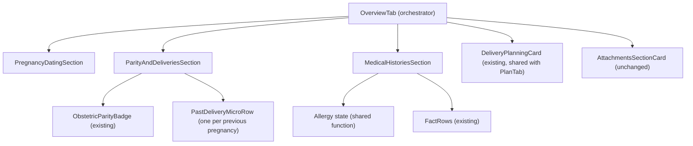

# Technical Design: Patient Workspace Overview Tab Optimization

* **Author:** sherifrad
* **Date:** 2026-11-09
* **Status:** PROPOSED
* **Reviewers:** none assigned yet
* **Related:** the patient directory card RFC in `docs/designs/` (same visual language and "More actions" sheet)

---

## 1. Problem Statement & Background

### 1.1 The Clinical Problem
In the native Android Antenatal Care EMR (`anc-emr-android-native`), the Patient Workspace `OverviewTab` is the landing screen when a maternal health chart opens. It stacks six bordered cards below the persistent `PatientHubHeader`. Heights below are estimates, not measurements:
1. `GestationalDatingCard` (about 180dp)
2. `ObstetricParityCard` (about 140dp)
3. `MedicalHistoriesCard` (about 220dp)
4. Prior pregnancies (`PreviousPregnancyCard` once per prior pregnancy; about 120dp each)
5. `DeliveryPlanningCard` (about 260dp)
6. `AttachmentsSectionCard` (about 160dp)

On a 360dp phone this causes three problems:
* **Duplicated information.** `PatientHubHeader` already shows Gestational Age (expanded and collapsed), EDD, maternal age, Gravida/Parity, blood group, allergies and attention flags. The Dating and Parity cards repeat these, using about 320dp (180 + 140) before new history appears.
* **Long prior-pregnancy stack.** Each prior pregnancy has its own bordered card. For a G4 P3 patient the three cards use about 360dp, pushing the delivery plan and attachments further down (the whole tab can pass 1,200dp, estimate).
* **Many container boundaries.** Six cards each have a border, tint and elevation, so a clinician parses container edges while scanning the record.

---

## 2. Overview

This design replaces the first four cards (dating, parity, histories, prior pregnancies) with one continuous surface of three titled sections separated by hairline dividers. The existing `DeliveryPlanningCard` and `AttachmentsSectionCard` stay below them, unchanged, and are shared with `PlanTab.kt` (decided 2026-11-09, see §8 item 1):
1. **Pregnancy Dating & Due Date**: Estimated Due Date (EDD) with its source, the dating method, and dating notes. GA is not repeated here because the header shows it.
2. **Obstetric Parity & Previous Pregnancies**: parity (`G P A`) with a two-line row per previous pregnancy (`Year · Outcome · Mode` on line 1; place, doctor and recorded notes on line 2).
3. **Medical, Surgical & Family Histories**: an allergy state at the top (recorded, explicitly none, or not recorded), then the medical, surgical and family histories.
4. **Delivery & Postpartum Plan**: the existing `DeliveryPlanningCard`, unchanged (facility, plan, postpartum, fees, Rh alert). One implementation, shared with the Plan tab.
5. **Documents & Attachments**: the existing `AttachmentsSectionCard`, unchanged (restyling it is out of scope).

---

## 3. Goals and Non-Goals

### 3.1 In-Scope Goals
* **One surface instead of cards.** Sections 1 to 3 use a shared `ClinicalGroupSection` container with a 24dp icon capsule, a title, an optional action, and a 0.75dp divider.
* **Header de-duplication.** The Overview body omits GA. `PatientHubHeader` shows GA in both its expanded and collapsed states (`PatientHubHeader.kt`). Print (`PatientPrintHtmlGenerator`) and share (`ClinicalSummaryGenerator`) are generated separately from the tab and already include GA; this design does not change them.
* **Compact previous-pregnancy rows.** Each previous pregnancy is a two-line row with a minimum height of 48dp. Outcome and Mode are never truncated, checked by a Compose UI test at 360dp width and 1.3 font scale.
* **Recorded text, not inferred values.** Line 2 of each row shows `placeAndDoctor` and `otherDetails` exactly as recorded. No GA or birth weight is inferred from free text (see §4.4).
* **No loss of recorded history.** Every field the old `PreviousPregnancyCard` showed has a place in the new row or stays in the editor (see §4.3).
* **Touch targets of at least 48dp** for every edit, delete and add control, using the existing `Modifier.minimumTouchTarget()` (`ui/Components.kt`).

### 3.2 Non-Goals (Out of Scope)
* **No database changes.** Room schema v6 is frozen: no new columns or tables without clinical sign-off (`AGENTS.md`, Core Architectural Constitution §4).
* **No cross-tab content.** Visits, Scans, Labs and Medications keep their tabs.
* **No compatibility shims.** Replaced composables are deleted, not kept as dead code (`AGENTS.md`, Constitution §3, Zero Legacy Baggage).
* **No structured GA or birth weight.** Deferred 2026-11-09 by the owner: it needs a schema change and clinical sign-off. Line 2 of the previous-pregnancy row shows recorded text only. A separate change may revisit it.
* **No restyle of the Documents card.** `AttachmentsSectionCard` is reused as is.
* **SAMD** means Software as a Medical Device. The constraints in this document that cite it are the schema freeze, the 48dp touch targets, and the rule that clinically relevant history must be visible without an extra tap.

---

## 4. Technical Architecture & Component Hierarchy

### 4.0 Existing code this design reuses
| Need | Existing code |
| :--- | :--- |
| Prior-delivery counts and the "no prior deliveries" text | `previousDeliveryCounts`, `isStillbirth`, `isEarlyLoss`, `previousDeliverySummary` in `model/ObstetricHistory.kt` |
| Rh negative test | `isRhNegative(bloodGroup: String?)` in `ui/ClinicalFormat.kt` (call it with `patient.bloodGroupText`) |
| 48dp touch target | `Modifier.minimumTouchTarget()` in `ui/Components.kt` |
| Parity display | `ObstetricParityBadge(gravida, parity, abortion)` |
| Label and value rows | `FactRow` in `ui/Components.kt` |
| Delete control | `DeleteIconButton` |
| Documents card | `AttachmentsSectionCard` |
| Delivery plan fields | `parseDeliveryNotes` in `ui/DeliveryNotesParser.kt` (`hospital`, `fees`, `plan`, `postpartum`) |

### 4.1 Component Architecture
New composables live under `ui/patienthub/components/`:

### 4.2 Section Container: `ClinicalGroupSection`
Replaces the elevated cards for sections 1 to 3.

* **Signature:** `ClinicalGroupSection(title: String, icon: ImageVector, iconTint: Color, iconBgColor: Color, actionButton: (@Composable () -> Unit)? = null, modifier: Modifier = Modifier, content: @Composable ColumnScope.() -> Unit)`.
* **Behaviour:**
  * A header row: a 24dp rounded icon capsule (decorative, `contentDescription = null`), the title (`titleMedium`, bold, `Modifier.weight(1f)` so a long title wraps instead of pushing the action out), and the optional action.
  * The title is marked `semantics { heading() }`. The action slot applies `Modifier.minimumTouchTarget()`.
  * Content follows the header. A 0.75dp `HorizontalDivider` (`outlineVariant`, decorative, no contrast requirement) separates one section from the next; there is no divider under the header.
  * Callers pass the section's test tag through `modifier` (see §7.1 Phase C).

### 4.3 Previous-Pregnancy Row (`PastDeliveryMicroRow`)
* **Size and targets:** minimum height 48dp; it grows with content and font scale. The whole row is the edit target (`Modifier.minimumTouchTarget()`). A trailing `DeleteIconButton` is the only other control. Both are hidden when editing is not allowed (`!canEdit`), as the old card did. Line 1 may wrap to two lines. Line 2 (place, doctor, notes) is `maxLines = 2` with ellipsis; the full text is in the editor. Line 3 holds the extras and any clinician outcome text in their own node (tag `pregnancyExtras-<id>`), wrapping freely, so loss management, termination method and pregnancy type are never clipped.
* **Line 1:** `Year` (monospaced tabular figures; the existing typography token or font must be confirmed in Phase B), the Outcome chip, and the Mode text.
* **Line 2:** place and doctor, then recorded notes.
* **Line 3 (only when present):** non-blank extras from the table below, then `outcomeText` when it differs from the structured outcome label.
* **Field mapping** (the implementer verifies against `PreviousPregnancyCard.kt` before coding):

| Row element | Source (`DemoPreviousPregnancy`) | Rule |
| :--- | :--- | :--- |
| Year | `dateText` | First 4-digit year in the text; if none, show `dateText` as recorded; if blank, "Date not recorded" |
| Outcome chip | `outcome` (`LiveBirth`, `Stillbirth`, `EarlyPregnancyLoss`, `TerminationOfPregnancy`), else `outcomeText` | The label text is always shown; colour is never the only signal. Chip colour: `Stillbirth` uses `errorContainer`; `EarlyPregnancyLoss` uses `tertiaryContainer`; `LiveBirth`, `TerminationOfPregnancy` and free-text outcomes use the neutral `surfaceContainerHigh` |
| Mode | `birthMethod`, else `deliveryBy` | Recorded text; blank is omitted. Counts elsewhere use `previousDeliveryCounts` |
| Line 2: place and doctor | `placeAndDoctor` | As recorded |
| Line 2: notes | `otherDetails` | As recorded |
| Line 2: extras | `pregnancyType`, `lossManagement`, `terminationMethod` | Each shown as a labelled segment when non-blank, using the existing `PreviousPregnancyCard` labels |
| Not shown in the row | `clinicianId`, `provenanceKind`, `recordedAt`, `updatedAt` | Unchanged in the editor |

### 4.4 No Parsing of GA or Birth Weight
GA at delivery and birth weight have no structured fields. This design does not infer them from `otherDetails` or `outcomeText`: a text pattern cannot tell "39w" at delivery from "2 weeks postpartum" or a drug dose, and a wrong value would look like a recorded one. Line 2 shows the recorded text instead. Structured biometrics need a schema change, which is a separate proposal that requires clinical sign-off.

### 4.5 Section Breakdown & Data Mapping

1. **Pregnancy Dating Section**
   - EDD: `agreedEdd ?: ultrasoundEdd ?: calculateEstimatedDueDate()`, labelled with its source (agreed, ultrasound, or calculated).
   - Method tag: `datingMethod` with values `LMP`, `Ultrasound`, `IVF_TRANSFER`, `Clinical` (`ClinicalModels.kt`).
   - Parameters: LMP date; IVF transfer date and embryo age (shown when the method is `IVF_TRANSFER`).
   - Notes: `dating.notes`.
2. **Parity & Previous Pregnancies Section**
   - `ObstetricParityBadge(patient.gravida, patient.parity, patient.abortion)`.
   - If `previousPregnancies` is empty, show `previousDeliverySummary(patient)`. The word "Primigravida" appears only when `gravida` is 1 or less. If G/P/A and the list disagree, show the existing summary, not a derived label.
   - Rows: `patient.previousPregnancies.forEach { PastDeliveryMicroRow(...) }` inside the section `Column`. There is no lazy list, because the tab is one `verticalScroll`. Expected size is at most about 10 rows.
   - Notes: `patient.obstetricNotes` through `FactRow` at the section bottom.
3. **Medical Histories Section**
   - Allergy state comes from one shared function with three results: `NotRecorded` (blank), `ExplicitlyNone`, `Recorded(text)`. The function is extracted from the inline test in `ui/Components.kt` (directory card), and the directory card, `PatientHubHeader` and this section all call it.
   - `NotRecorded` shows the existing `not_recorded` string. `ExplicitlyNone` shows the calm no-allergy line, and only when the whole entry is a negation (for example exactly "NKDA", "None", "No known drug allergies"). An entry that continues with other text ("No known allergies except penicillin") is `Recorded`. The current inline test uses `contains`, which would hide such an allergy, so the shared function is stricter. `Recorded` shows the `errorContainer` banner at the section top.
   - Then `patient.medicalHistory`, `patient.surgicalHistory`, `patient.familyHistory`.
4. **Delivery & Postpartum Plan**
   - `DeliveryPlanningCard`, unchanged except the new `canEdit` gate (see §4.6), and still also used by `PlanTab.kt`. It already provides the parsed facility, plan, postpartum and fees fields, `not_recorded` for missing values, and the Rh alert through `isRhNegative(patient.bloodGroupText)`. No new composable, string or parser change.
5. **Documents & Attachments**
   - `AttachmentsSectionCard`, unchanged (still also used by `PlanTab.kt`).

### 4.6 Signatures and Events
* Each section composable takes plain callbacks, or `null` when `!canEdit`. `OverviewTab` keeps building the `AncEvent`s it builds today: `StartDatingEditor`, `StartPregnancyEditor`, `StartPatientEditor` and `RequestDelete`.
* Edit gating for `DeliveryPlanningCard`: decided 2026-11-09. The card gets a `canEdit: Boolean` parameter and shows the `editDeliveryPlan` button only when it is true. `OverviewTab` and `PlanTab` (which already receives `canEdit`) both pass it. This fixes the Plan tab, which today shows the edit button for read-only and archived patients.
* Rule 1 (one implementation per clinical entity): decided 2026-11-09. Overview and `PlanTab.kt` both call `DeliveryPlanningCard`; there is no second Delivery Plan composable.

---

## 5. Alternatives Considered

| Alternative | Decision and evidence |
| :--- | :--- |
| **Keep the cards with less padding** | Rejected. Borders, separate surfaces and elevations cost an estimated 96dp of padding and keep six container boundaries. |
| **Single-line 5-column table** | Rejected. `Year / Mode / Outcome / GA / Birth Weight` in one row needs an estimated 440dp. At 328dp usable width the text truncates ("Liv...", "Vag...") or needs horizontal scrolling. |
| **Collapsible previous pregnancies** | Rejected. Prior Cesarean and complication history must be visible without a tap. |
| **Add GA and birth weight columns** | Rejected. Room validates a schema identity hash; any entity change needs a version bump and migration, which the constitution forbids without clinical sign-off. Parsing free text instead was also rejected (§4.4): it can show wrong values as fact. |
| **Structured GA and weight entry in the pregnancy editor** | Deferred. It needs sign-off or a free-text convention that users can edit away. Revisit with the schema proposal. |
| **Flatten the existing cards** (no border, hairline divider, duplicated fields removed) | Open (see §8). It reuses cards and their tags and `canEdit` handling, and would shrink the file list. Not yet compared with measurements. |
| **No section headers or dividers** | Rejected. Dating, Parity, Histories and Plan run together without boundaries. |

---

## 6. Risks & Mitigations

| Risk | Mitigation |
| :--- | :--- |
| Removed fields hide history | Field mapping in §4.3; extras shown on line 2; unchanged editor |
| Allergy shown wrongly (red alert for "no allergy", or "none" for a blank field) | Three states from one shared function, with a unit test including "No known allergies except penicillin" |
| Row clips at 360dp or large fonts | Minimum height, wrapping, Compose UI test at 360dp and 1.3 font scale |
| Existing tests break | Tag table in §7.1 Phase C; instrumented tests run before and after |
| Many previous pregnancies | Plain `Column`/`forEach`, stated expected size, same scrolling as today |
| Wrong value shown as recorded | No inferred values (§4.4) |
| Revert | One change set; `git revert` restores the six cards. No data or schema changes |

---

## 7. Detailed Implementation Plan

### 7.1 Phases
Each phase leaves the build green. Strings are added in Phase A because later phases use them.

**Phase A: shared logic and strings**
1. Extract the allergy-state function from `ui/Components.kt` and call it from the directory card and `PatientHubHeader` (changing their blank-as-NKDA behaviour). Add unit tests for blank, "NKDA", "None", "No known drug allergies", and "No known allergies except penicillin".
2. Add string resources. Reuse: `previous_pregnancies`, `no_previous_pregnancies`, `no_allergy_history`, `not_recorded`, `historical_delivery_mode`, `place_and_doctor`, `other_details`, `ga_prefix`. Add, with exact English values: the three section titles, the allergy banner label, and content descriptions for edit and delete.
3. Exit: `./gradlew testDebugUnitTest`.

**Phase B: new composables, not wired**
1. Create `ClinicalGroupSection.kt`, `PastDeliveryMicroRow.kt`, `OverviewSections.kt` (one file per section if it passes 400 lines; ceiling 1,500 lines per `AGENTS.md`). Confirm the tabular-figures font or typography token.
2. Exit: `./gradlew assembleDebug`.

**Phase C: swap and delete**
1. Refactor `OverviewTab.kt` to the three new sections plus the existing `DeliveryPlanningCard` and `AttachmentsSectionCard`. Budget: at most 180 lines (152 today); it keeps the `AncEvent` construction.
2. Delete `GestationalDatingCard`, `ObstetricParityCard`, `MedicalHistoriesCard` and `PreviousPregnancyCard` (grep confirmed `OverviewTab.kt` is the only caller). `DeliveryPlanningCard` and `AttachmentsSectionCard` stay because `PlanTab.kt` uses them.
3. Keep every existing test tag:

| Tag | Carried by after the change |
| :--- | :--- |
| `datingCard`, `obstetricParityCard`, `medicalHistoriesCard` | The matching section container, through its `modifier` |
| `editDating`, `addPregnancyButton` | The same buttons, now in the section action slot |
| `pregnancy-<id>` | Outer container of `PastDeliveryMicroRow` |
| `editPregnancy-<id>` | Inner clickable content node of the row (a different node from the outer container) |
| `delete-previous_pregnancy-<id>` | `DeleteIconButton`, unchanged |
| `deliveryPlanningCard`, `editDeliveryPlan`, `deliveryHospital`, `deliveryFees`, `deliveryPlan`, `deliveryPostpartum` | `DeliveryPlanningCard`, unchanged |
| `obstetricParityBadge` | `ObstetricParityBadge`, unchanged |
| `attachmentsSectionCard`, `addAttachmentBtn` | `AttachmentsSectionCard`, unchanged |

4. Add a Compose UI test for the row at 360dp width and 1.3 font scale (Outcome and Mode not truncated), and tests for the empty-list summary and the three allergy states. The Rh alert is covered by the existing card.
5. Exit: `./gradlew testDebugUnitTest` and `./gradlew connectedDebugAndroidTest` (or `.agents/scripts/run_emulator_test_class.sh`). Instrumented tests that use these tags and must keep passing: `AncWorkflowTest` (`editDating`, `deliveryPlanningCard`) and `DeleteUndoUiTest` (`pregnancy-` prefix). `PatientHubPureModelTest` is a JVM unit test under `app/src/test/.../ui/patienthub/model/` and runs in the unit-test step. `PatientHubDesignTest` exists in `androidTest` but does not reference these tags (checked by grep); run it anyway as a regression check.

**Phase D: device check (advisory)**
1. Install the debug build on the physical device (Honor DNY-NX9) with ADB.
2. Screenshot a seeded multiparous patient and a seeded nulliparous patient at 360dp (name the fixture ids from `DemoFixtures.kt`) and check the layout.

### 7.2 Enumerated Files Touched

| File Path | Action | Rationale |
| :--- | :--- | :--- |
| `app/src/main/java/com/sherifradwan/ancnative/ui/Components.kt` | **MODIFIED** | Extract the shared allergy-state function; directory card uses it |
| `app/src/main/java/com/sherifradwan/ancnative/ui/patienthub/PatientHubHeader.kt` | **MODIFIED** | Header allergy display uses the shared function |
| `app/src/test/java/com/sherifradwan/ancnative/ui/AllergyStateTest.kt` (proposed) | **CREATED** | Unit tests for the three allergy states |
| `app/src/main/java/com/sherifradwan/ancnative/ui/patienthub/components/ClinicalGroupSection.kt` (proposed) | **CREATED** | Section container |
| `app/src/main/java/com/sherifradwan/ancnative/ui/patienthub/components/PastDeliveryMicroRow.kt` (proposed) | **CREATED** | Previous-pregnancy row |
| `app/src/main/java/com/sherifradwan/ancnative/ui/patienthub/components/OverviewSections.kt` (proposed) | **CREATED** | Dating, Parity and Medical Histories sections |
| `app/src/main/java/com/sherifradwan/ancnative/ui/patienthub/tabs/OverviewTab.kt` | **MODIFIED** | Orchestrator on the new sections |
| `app/src/main/java/com/sherifradwan/ancnative/ui/patienthub/components/GestationalDatingCard.kt` | **DELETED** | No remaining callers |
| `app/src/main/java/com/sherifradwan/ancnative/ui/patienthub/components/ObstetricParityCard.kt` | **DELETED** | No remaining callers |
| `app/src/main/java/com/sherifradwan/ancnative/ui/patienthub/components/MedicalHistoriesCard.kt` | **DELETED** | No remaining callers |
| `app/src/main/java/com/sherifradwan/ancnative/ui/patienthub/components/PreviousPregnancyCard.kt` | **DELETED** | No remaining callers |
| `app/src/main/java/com/sherifradwan/ancnative/ui/patienthub/components/DeliveryPlanningCard.kt` | **MODIFIED** | Add `canEdit` and hide `editDeliveryPlan` when false; otherwise unchanged. Reused by Overview and `PlanTab.kt` |
| `app/src/main/java/com/sherifradwan/ancnative/ui/patienthub/tabs/PlanTab.kt` | **MODIFIED** | Pass `canEdit` to `DeliveryPlanningCard` |
| `app/src/main/java/com/sherifradwan/ancnative/ui/patienthub/components/AttachmentsSectionCard.kt` | **UNCHANGED** | Reused by Overview and `PlanTab.kt` |
| `app/src/androidTest/java/com/sherifradwan/ancnative/` (new Compose test for the row) | **CREATED** | 360dp, 1.3 font scale |
| `app/src/main/res/values/strings.xml` | **MODIFIED** | New keys listed in Phase A |

Paths checked on 2026-11-09: all six card files exist at the paths above. Callers (grep): the four deleted cards are called only from `OverviewTab.kt`; `DeliveryPlanningCard` from `OverviewTab.kt` and `PlanTab.kt`; `AttachmentsSectionCard` from `OverviewTab.kt` and `PlanTab.kt`.

---

## 8. Open Questions

1. **Delivery Plan duplication.** Evidence (checked 2026-11-09): `PlanTab.kt` already renders `DeliveryPlanningCard` and `AttachmentsSectionCard` in full, and `OverviewTab.kt` renders the same two. `DeliveryPlanningCard` (173 lines) already parses `obstetricNotes` with `parseDeliveryNotes`, applies the Rh check (`isRhNegative`), and carries the tags `deliveryPlanningCard`, `editDeliveryPlan`, `deliveryHospital`, `deliveryFees`, `deliveryPlan`, `deliveryPostpartum`. A new `DeliveryPlanSection` would be a third copy of that content. **Decided 2026-11-09 by the owner: option (a).** Options were: (a) the Overview calls the existing `DeliveryPlanningCard` unchanged and the design needs no `DeliveryPlanSection` or Rh alert text; (b) a new shared composable replaces the card in both tabs; (c) the Overview drops the plan snapshot because the Plan tab has it (contradicts §3.2). This decides the file list.
2. **Delivery Plan edit gating.** Decided 2026-11-09 by the owner: gate `onEditPatient` by `canEdit` (see §4.6).
3. **Outcome chip colours.** Decided 2026-11-09 (accepted review proposal): `Stillbirth` uses `errorContainer`, `EarlyPregnancyLoss` uses `tertiaryContainer`, all others use the neutral `surfaceContainerHigh` (see §4.3). Both severity colours are already used in `BedsideVitalsGrid.kt` and `PatientHubHeader.kt`.
4. **Section title.** Decided 2026-11-09: keep the existing `previous_pregnancies` string. Losses and terminations are shown by the Outcome chip.
5. **Print or share.** Closed: print and share are separate generators that already include GA (`PatientPrintHtmlGenerator.kt:1058`, `ClinicalSummaryGenerator.kt:22-23`); the design does not change them.
6. **Schema.** Closed 2026-11-09: structured GA and birth weight are deferred as a non-goal (see §3.2).
7. **Documents card.** Closed: see §3 Non-Goals.
