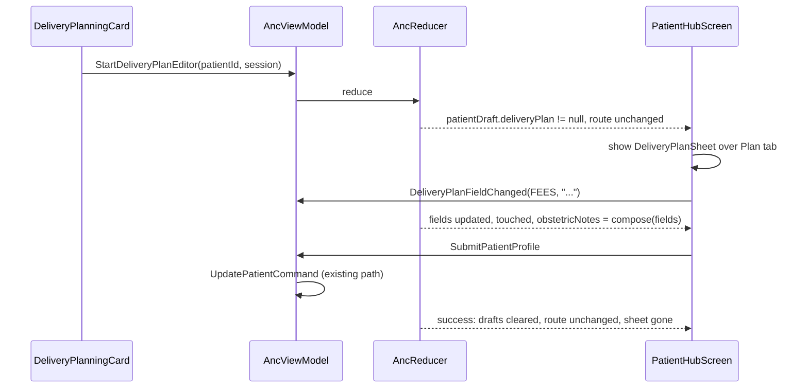

# Design: edit the delivery plan in place on the Plan tab

*   **Author:** sherifrad (draft by the agy Claude Opus lane, reviewed by other lanes)
*   **Status:** Proposed
*   **Date:** 2026-11-11

--------------------------------------------------------------------------------

## 1. Overview

On the Plan tab, the pencil on the Delivery Planning card (`editDeliveryPlan` in [DeliveryPlanningCard.kt](file:///Users/sherifgamalradwan/anc-emr-android-native/app/src/main/java/com/sherifradwan/ancnative/ui/patienthub/components/DeliveryPlanningCard.kt)) sends `AncEvent.StartPatientEditor`. The reducer `startPatientEditor` ([ClinicalDraftReducers.kt](file:///Users/sherifgamalradwan/anc-emr-android-native/app/src/main/java/com/sherifradwan/ancnative/state/ClinicalDraftReducers.kt#L41-L64)) sets `route = AncRoute.PatientEditor(...)`. That replaces the Plan tab with the full 638-line profile form, where the only relevant field is the free-text "Obstetric notes" (`PatientDraftField.OBSTETRIC_NOTES`).

This change replaces that navigation with a bottom sheet over the Plan tab. The sheet edits the four boxes the card shows (Agreed Delivery Hospital, Agreed Delivery Fees, Delivery Plan, Postpartum Note) and saves them back into `obstetricNotes`. The route does not change, the schema does not change, and saving goes through the existing profile save path (`SubmitPatientProfile`, `UpdatePatientCommand`).

The hard part is the write-back. Storage is one free-text string, and the four boxes come from a heuristic classifier (`parseDeliveryNotes`). The design defines one fixed text format for saved notes, makes a small, exact addition to the parser so that format always parses back to what was typed, and proves the round trip.

## 2. Goals

1. The pencil opens a bottom sheet over the Plan tab. The route stays the same, the pager and tab stay put, and nothing reloads.
2. The sheet shows the four boxes as four editable fields, filled from what the card shows now.
3. Save writes the four fields back into `obstetricNotes` through the existing patient draft and `SubmitPatientProfile`. There is no new command and no new column.
4. After a save, the card shows exactly what the doctor typed in each field. The only normalisation is trimming each line, dropping blank lines and removing duplicate hospital lines. This is proven in section 5.4.
5. Dirty, discard, saving and failed-save behaviour match `MedicationSheet`.
6. The layout works at 360 dp with nothing critical cut off, and the focused field stays visible above the keyboard.
7. AGENTS.md rules hold: one canonical component per entity, no UI file over 1,500 lines, unidirectional MVI, no dead code, no shims.

## 3. Non-Goals

1. Structured delivery columns or any Room change. Schema v6 stays frozen.
2. Redesigning the patient profile form ([PatientEditor.kt](file:///Users/sherifgamalradwan/anc-emr-android-native/app/src/main/java/com/sherifradwan/ancnative/ui/PatientEditor.kt)) or the new registration flow. That is a separate, later task.
3. Changing how the heuristic parser classifies lines that are not in the new labelled format (one narrow exception is listed in Decision 4).
4. Moving other obstetric content (for example obstetric history typed into the notes) into its own field.
5. Translating the stored labels. They are fixed tokens (Decision 11).
6. Changing the print or clinical summary generators beyond confirming they still read well.

## 4. Decisions

**D1. The sheet sits over the Plan tab and never touches `route`.**
Reason: the route swap is the bug, and the Meds tab already solved it the same way. A new reducer `startDeliveryPlanEditor` builds the draft without setting `route`. The sheet shows when the draft slice is present and closes when the slice is cleared.

**D2. Reuse `PatientDraft`, and add one optional sub-slice `deliveryPlan: DeliveryPlanFields?`.**
Reasons:
- `SubmitPatientProfile` and `UpdatePatientCommand` already take a `PatientDraft`, with `baseRevision` conflict handling and `SaveUiError` mapping. A second command would duplicate the write path.
- The draft values come from `toPatientDraftValues()`, exactly as the current pencil path does. So a save from the sheet writes the same non-notes fields that a save from today's form would write, and the risk on the other columns is no greater than today.
- The four raw field strings must live in state, not be re-parsed from `obstetricNotes` on every keystroke. Compose trims lines, so re-parsing would eat a trailing space or newline while the doctor types.
- Putting the sub-slice inside `PatientDraft` means it is created, cleared, saved and restored together with the draft. `clearDrafts()` already clears `patientDraft`; that it clears every field is inferred from `startPatientEditor`, not verified.

**D3. Saved notes use a fixed labelled-line format: one line per non-blank line of each field, prefixed with the field's label.**
The labels are exactly the card titles: `Agreed Delivery Hospital`, `Agreed Delivery Fees`, `Delivery Plan`, `Postpartum Note`. The order is always hospital, fees, plan, postpartum.
Reason: the stored text reads naturally in the patient form, in print and in the clinical summary, and it maps one to one onto the four boxes. Full rule in section 5.3.

**D4. Add one strict rule to the parser: a line that starts with one of the four exact labels (case-sensitive) followed by ':' and a non-blank value goes wholly into that box.**
Such a line is not split, not classified by heuristic, and adds no derived hospital name. Every other line is parsed as today.
Reason: with the parser unchanged, no compose rule round-trips what the doctor types. Counterexamples taken from the pasted code:
- (a) `Plan:` and `Hospital:` labels are not stripped (line 139, `label != null -> Placement(Home.PLAN, text)`). Composing `Plan: SVD` shows "Plan: SVD" in the box, not "SVD".
- (b) Any line with a known label is split at ';' and at sentence ends, and each piece is classified alone. Fees typed as `5000 EGP; includes 2 nights` compose to `Fees: 5000 EGP; includes 2 nights`. The second piece has no label and no fee word, so it lands in Delivery Plan.
- (c) A label is only seen on the first piece. Plan typed as `Package 20000 EGP` with no label goes to Fees (`FEE_KEYWORD`). With a `Plan:` label it shows "Plan: Package 20000 EGP" (see a).
- (d) Fees typed as `quoted 30000` with a `Fees:` label goes to Delivery Plan (`UNCONFIRMED_FEE`, line 138).
- (e) The hospital box is derived. Writing `Hospital: X` also echoes "Hospital: X" into Delivery Plan (line 139). Clearing the hospital field while Delivery Plan still says "at X Hospital" would bring X back on the next parse.

Narrow behaviour change: a hand-typed line beginning with exactly `Postpartum Note:` or `Delivery Plan:` (this exact case) in an older note now goes wholly to that box and adds no derived hospital. Lowercase variants such as `Postpartum note:` keep today's behaviour. Tests pin both cases.

**D5. After the first save, the hospital box holds exactly what the doctor typed in the Hospital field.**
Reason: an explicit field has to be clearable and must not fill itself again from other text. Before the first save, the box is still the derived list.

**D6. Saving rewrites the notes only when something changed, and the sheet warns before the first rewrite.**
- Save with `touched == false` closes the sheet and writes nothing.
- If the stored notes are not already in the labelled format (`!isComposedDeliveryNotes(notes)`, section 5.3), the sheet shows a notice at the top.
- Once notes are in the format, saving unchanged fields writes back identical text (section 5.4 proves compose is idempotent), so the rewrite happens at most once per patient.
Reason: no silent rewrite of clinical text the doctor did not touch.

**D7. Move the parser from `ui/DeliveryNotesParser.kt` to `model/DeliveryNotes.kt`, with compose next to it.**
Reason: the reducer (in `state/`) must compose on every field change. `state/` already imports `model/` (see the imports in ClinicalDraftReducers.kt). Importing `ui/` from `state/` would invert the layers. Whether any `state/` file already imports `ui/` is not verified.

**D8. Pull the sheet pieces that `MedicationSheet` and the new sheet share into one file.**
The pieces: save message, Cancel/Save row, discard dialog, and the guarded sheet state. The new file is `ui/patienthub/components/EditorSheetParts.kt`.
Reason: AGENTS.md Rule 1. The save-failure message, disabled-while-saving buttons and discard rules are one behaviour and need one implementation. `MedicationSheet` keeps its test tags through parameters.

**D9. Dirty and discard rules copy the medication sheet.**
A `touched` flag lives in `DeliveryPlanFields`. Cancel or dismiss when untouched closes at once. When touched, it asks with the existing `discard_changes`/`discard_body` dialog. Dismiss is blocked while saving.
Reason: same behaviour on both tabs, and it is already tested on Meds.

**D10. Guards are the same as `startPatientEditor`.**
Opening does nothing if `savePhase.blocksEditing()`, if `hasDirtyDraft`, or if the patient is missing or `status == "archived"`. Field changes do nothing while `blocksEditing()`.
Reason: one rule set for every editor. A dirty draft cannot normally exist while the Plan tab is on screen, because every other editor either owns a route or is a modal sheet on another tab, so a silent no-op is enough (same as `startPatientEditor`).

**D11. The stored labels are fixed constants in `model/DeliveryNotes.kt` and are never translated.** The card and sheet titles move to string resources, with the same English values.
Reason: the parser reads the stored labels, so they must not change with locale. The card currently hard-codes the four titles (lines 159, 166, 173, 180). Moving them to resources lets the card and the sheet share one source for display text.

## 5. Technical Plan

### 5.1 State

State files are not pasted, so the exact file is not verified (likely `state/AncState.kt`).

```kotlin
data class DeliveryPlanFields(
    val hospital: String,
    val fees: String,
    val plan: String,
    val postpartum: String,
    val touched: Boolean = false,
    val rewritesNotes: Boolean,   // stored notes not yet in composed format: show the notice
)

// PatientDraft gains one field with a default, so existing constructors compile unchanged:
val deliveryPlan: DeliveryPlanFields? = null
// non-null means "this draft belongs to the Plan tab sheet"
```

The sheet is visible when:

```
state.patientDraft?.deliveryPlan != null && state.patientDraft.patientId == <hub patient id>
```

### 5.2 Events and reducer

New events (file `state/AncEvent.kt`, not verified):

```kotlin
data class StartDeliveryPlanEditor(val patientId: String, val editorSessionId: String) : AncEvent
data class DeliveryPlanFieldChanged(val field: DeliveryPlanField, val value: String) : AncEvent
enum class DeliveryPlanField { HOSPITAL, FEES, PLAN, POSTPARTUM }
```

The sheet reuses `AncEvent.SubmitPatientProfile` and `AncEvent.CancelEditor`.

Reducers, added to ClinicalDraftReducers.kt:

```
startDeliveryPlanEditor(state, e):
  if state.savePhase.blocksEditing() || state.hasDirtyDraft -> state
  patient = state.patient(e.patientId)?.takeIf { status != "archived" } ?: return state
  values  = patient.toPatientDraftValues()
  s       = parseDeliveryNotes(patient.obstetricNotes)
  state.clearDrafts().copy(            // no route change
    patientDraft = PatientDraft(e.editorSessionId, patient.id, patient.revision,
                                patient.createdAt, original = values, values = values,
                                deliveryPlan = DeliveryPlanFields(
                                  s.hospital.orEmpty(), s.fees.orEmpty(), s.plan.orEmpty(), s.postpartum.orEmpty(),
                                  rewritesNotes = !isComposedDeliveryNotes(patient.obstetricNotes))),
    savedNotice = false, notice = null)

updateDeliveryPlanField(state, e):
  if state.savePhase.blocksEditing() -> state
  draft  = state.patientDraft ?: return state
  fields = draft.deliveryPlan ?: return state
  next   = fields.with(e.field, e.value).copy(touched = true)
  state.copy(
    patientDraft = draft.copy(
      deliveryPlan = next,
      values = draft.values.copy(obstetricNotes = composeDeliveryNotes(next.toSections())),
      errors = emptySet()),
    savePhase = SavePhase.IDLE, saveError = null)
```

`toSections()` maps a blank field to `null`.

Changes in the existing paths. Where these live (`AncReducer` or `AncViewModel`) is not verified:

- **SubmitPatientProfile** with `deliveryPlan != null && !touched`: clear the drafts and do not issue a command.
- **SubmitPatientProfile success** with `deliveryPlan != null`: clear the drafts and keep the current `route`. If the current success branch sets a route (not verified), skip that when `deliveryPlan != null`.
- **SubmitPatientProfile failure**: as today. The draft and values stay, `savePhase = ERROR`, and `saveError` is set.
- **CancelEditor** with `deliveryPlan != null`: clear the drafts and keep the route. That CancelEditor already keeps the route for the medication sheet is not verified.
- **Draft persistence across process death**, if it exists (not verified): it must serialise `deliveryPlan` with `PatientDraft`. Because the slice is inside `PatientDraft`, both are restored together or not at all. If the persistence stores drafts field by field and cannot hold the new field, the fallback on restore is: a `patientDraft` whose route is not `PatientEditor` and has no `deliveryPlan` is dropped. Otherwise an invisible dirty draft would block every other editor. A save that was running at the crash is handled by the existing `RECONCILING`/`UNRESOLVED` phases.

### 5.3 The compose rule (in `model/DeliveryNotes.kt`)

```kotlin
internal const val LABEL_HOSPITAL   = "Agreed Delivery Hospital"
internal const val LABEL_FEES       = "Agreed Delivery Fees"
internal const val LABEL_PLAN       = "Delivery Plan"
internal const val LABEL_POSTPARTUM = "Postpartum Note"

internal fun composeDeliveryNotes(s: DeliveryNoteSections): String =
    listOf(LABEL_HOSPITAL to s.hospital, LABEL_FEES to s.fees,
           LABEL_PLAN to s.plan, LABEL_POSTPARTUM to s.postpartum)
        .flatMap { (label, value) ->
            value.orEmpty().lines().map { it.trim() }.filter { it.isNotEmpty() }
                .let { if (label == LABEL_HOSPITAL) it.distinct() else it }
                .map { "$label: $it" }
        }
        .joinToString("\n")

internal fun isComposedDeliveryNotes(notes: String?): Boolean =
    notes.isNullOrBlank() || composeDeliveryNotes(parseDeliveryNotes(notes)) == notes
```

Parser addition (D4). The check runs first inside the existing `for (line in lines)` loop:

```kotlin
private val COMPOSED_LINE = Regex(
    "^(Agreed Delivery Hospital|Agreed Delivery Fees|Delivery Plan|Postpartum Note):\\s*(\\S.*)$",
    RegexOption.DOT_MATCHES_ALL,   // '.' must also match U+2028/U+0085, which lines() does not split on
)
// in the loop:
COMPOSED_LINE.matchEntire(line)?.let { m ->
    val value = m.groupValues[2].trim()
    when (m.groupValues[1]) {
        LABEL_HOSPITAL -> hospitals += value
        LABEL_FEES -> fees += value
        LABEL_PLAN -> plan += value
        else -> postpartum += value
    }
    continue
}
// ...existing segment code unchanged...
```

The KDoc above `parseDeliveryNotes` gets one added paragraph describing the strict rule. The existing paragraphs stay.

**Worked example.** The stored notes are:

```
Delivery at Cleopatra Hospital
Fees: 20000 EGP
Postpartum: IUD at 6 weeks
```

Today's parse gives:
- hospital `Cleopatra Hospital` (the phrase match; "Delivery at" is not part of the phrase because "at" is not an allowed connector)
- fees `20000 EGP` (FEE label, stripped)
- plan `Delivery at Cleopatra Hospital` (fallback)
- postpartum `IUD at 6 weeks`

The first save without changes is a no-op (D6). After the doctor edits any field and saves, the notes become:

```
Agreed Delivery Hospital: Cleopatra Hospital
Agreed Delivery Fees: 20000 EGP
Delivery Plan: Delivery at Cleopatra Hospital
Postpartum Note: IUD at 6 weeks
```

### 5.4 The round-trip proof

**Definitions.**
- `lines()` and `trim()` are the Kotlin functions both sides already use. `trim()` removes `Char.isWhitespace` characters, which include every character the regex treats as `\s`.
- **Invariant I** on a section value `v`: either `v == null`, or `v == L.joinToString("\n")` for a non-empty list `L` where every element is non-empty, equals its own `trim()`, and contains no `\n` or `\r`. For the hospital value, the elements are also distinct.
- **N(U)**, for any four raw field strings `U`: per field, `lines()`, then `trim`, then drop empty lines, then (hospital only) `distinct()`, then join with `"\n"`, giving `null` if nothing is left.

**Lemma 1: every output of `parseDeliveryNotes` satisfies I.**
- Heuristic elements come from `pieceOf`, which trims with `isWhitespace`, or from `stripLabel`, which calls `trim()` and returns the non-blank original line if the value is blank.
- A rejoined element starts with a trimmed first piece and ends with a trimmed last piece, so it has no whitespace at either end.
- Every element comes from one item of `notes.lines()`, so it contains no `\n` or `\r`.
- Hospital names are trimmed (`acceptedName`, the trimmed phrase group, which starts with a capital letter and ends with "Hospital"). They are distinct because they are collected in a `LinkedHashSet`.
- Strict-rule elements are `group2.trim()`, and `group2` starts with `\S`, so they are non-empty.
- Each list is joined with `"\n"`. An empty list gives `null` through `ifBlank`, and a non-empty list of non-blank elements is never blank.

**Lemma 2: every line of `composeDeliveryNotes(S)` matches `COMPOSED_LINE`, with group 1 equal to its label and group 2 equal to its value `l`.**
- Each emitted line is `"$label: $l"`, where `l` is non-empty and equals `l.trim()`.
- So `l[0]` is not whitespace, `\s*` matches exactly the one space, and `\S.*` (with DOT_MATCHES_ALL) matches the whole of `l`.
- The parser trims each line first. That changes nothing, because the label has no leading whitespace and `l` has no trailing whitespace.
- No label is a prefix of another (the two "Agreed Delivery" labels differ at the next word), so group 1 is the emitted label.
- A value that itself starts with a label (for example Delivery Plan containing `Agreed Delivery Fees: 5000`) does not matter. The regex is anchored at `^`, so it matches the line's own label first.
- The compose output contains only `"\n"` separators, so `lines()` gives back exactly the emitted lines.

**Theorem A: for any raw fields U, `parseDeliveryNotes(composeDeliveryNotes(U)) == N(U)`.**
By Lemma 2, every line takes the strict branch and the heuristic code never runs. Each value is appended to its own field's list in emitted order. The emitted lines per field are exactly the lines of N(U) for that field, and hospital lines are already distinct, so the `LinkedHashSet` keeps all of them in order. Joining with `"\n"` rebuilds N(U), and a field with no lines gives `null`.

**Theorem B: for any S the parser could produce, `parseDeliveryNotes(composeDeliveryNotes(S)) == S`.**
By Lemma 1, S satisfies I, so N(S) = S: trimming changes nothing, there are no blank lines to drop, and hospital lines are already distinct. Then apply Theorem A.

**Corollary C (idempotence): `composeDeliveryNotes(parseDeliveryNotes(composeDeliveryNotes(U))) == composeDeliveryNotes(U)`.**
By Theorem A, the left side is compose(N(U)). Compose itself applies the same trim, drop and distinct steps, so compose(N(U)) = compose(U). Therefore `isComposedDeliveryNotes` is true right after any save, the notice never shows again, and saving unchanged fields writes identical text.

**What happens to the hospital list.**
- On open, the Hospital field is filled with the derived list, one name per line.
- On save, those lines are written as `Agreed Delivery Hospital:` lines. From then on the box shows exactly those lines and nothing is derived from strict lines (D5).
- The plan text that mentions the hospital stays in Delivery Plan. The duplication the card shows today ("Cleopatra Hospital" in both boxes) is kept, and either box can now be edited on its own.

**What happens to text placed by heuristic.**
It is frozen where it is shown. For example, `Fee quoted 30000 EGP` lands in Delivery Plan today (`UNCONFIRMED_FEE`) and is saved as `Delivery Plan: Fee quoted 30000 EGP`. The doctor can move it to another field before saving.

Losses on conversion:
- Label words stripped by the heuristic are not kept. `Fees agreed: 5000` becomes `Agreed Delivery Fees: 5000`, so "agreed" survives only through the box title; `Fee package: 20000` loses "package".
- Lines are regrouped by section, so the original line order across sections changes.
- No content text is dropped. The parser never drops a segment, and every box value is written back.

**What the user sees.** The first edit rewrites the patient's notes into labelled lines.
- **In the sheet:** the notice (tag `deliveryPlanRewriteNotice`) reads: "Saving will rewrite this patient's obstetric notes as labelled lines, one per box. Text the app sorted automatically keeps the box it is shown in. Check each box before saving." It shows only when `rewritesNotes` is true.
- **Patient form:** the "Obstetric notes" field (`patientObstetricNotes`) shows the labelled lines as plain text. The doctor can still edit there. Lines kept in the exact format stay strict, and any other line goes through the heuristic as today.
- **Print and clinical summary:** both read `obstetricNotes`. If they print it raw, the labelled lines read as plain sentences. If they call `parseDeliveryNotes`, they get the exact boxes. Which of the two they do is not verified, and checking it is step 12 of the implementation plan.

### 5.5 UI: `DeliveryPlanSheet`

Built on `ModalBottomSheet` with `skipPartiallyExpanded = true` and tag `deliveryPlanSheet`. Layout, top to bottom:

1. While saving, a `LinearProgressIndicator` (tag `deliveryPlanSaveProgress`).
2. The title "Edit delivery plan", reusing `R.string.edit_delivery_plan`, marked as a heading.
3. A scrolling body (`weight(1f, fill = false)`, `verticalScroll`, 16 dp side padding, 12 dp spacing) containing:
   - `SheetSaveMessage` (shared, tag `deliveryPlanSaveMessage`). It shows reconciling, unresolved, the `saveError.stringRes()` message, or a field-error message, and scrolls into view on failure through the existing `revealWhen`. Where `revealWhen` is defined is not verified; it is reused, not copied. If the submit fails with errors on profile fields the sheet does not show, the field-error line uses the new string `delivery_plan_profile_invalid`: "This patient's profile has a problem in a field not shown here. Open the full profile to fix it."
   - The rewrite notice, when `rewritesNotes` is true.
   - Four fields, each with a visible `Text` label above (it wraps and is never cut off at 360 dp or large font scales) and an `OutlinedTextField` below. Each field is full width, multi-line, `KeyboardCapitalization.Sentences`, enabled only when `savePhase` is `IDLE` or `ERROR`, labelled for accessibility through `semantics`, and shows `R.string.no_record` as its placeholder.
     - Hospital: tag `deliveryPlanHospitalField`, supporting text "One hospital per line".
     - Fees: tag `deliveryPlanFeesField`, supporting text "Agreed fees only. Put quotes or estimates in Delivery Plan."
     - Plan: tag `deliveryPlanPlanField`, `minLines = 3`.
     - Postpartum: tag `deliveryPlanPostpartumField`.
4. A `SheetCancelSaveRow` (shared) with two equal-weight buttons, labels on up to 2 lines, and `minimumTouchTarget()`. The tags are `cancelDeliveryPlan` and `saveDeliveryPlan`, and a spinner plus "Saving" label appears while saving.
5. The footer slot, which the host fills with the Undo bar exactly as it does for `MedicationSheet`. How the host passes that bar is not verified.

**Keyboard.** `imePadding()` on the sheet column, as in MedicationSheet. A text field inside a `verticalScroll` asks to be scrolled into view when it gets focus, so the focused field stays visible above the keyboard. This is checked by hand at 360 dp (Verification). No field takes focus when the sheet opens, so the notice and the first field are seen first.

**Dismiss.** Same as MedicationSheet: drag-down and back are blocked while saving, ask first when touched, and close at once when not. The dialog reuses `discard_changes`, `discard_body`, `discard` and `keep_editing`, with tags `deliveryPlanDiscardDialog`, `deliveryPlanDiscardConfirm` and `deliveryPlanDiscardKeep`.

**Empty states.** With empty notes, all fields are empty, the placeholders show and there is no notice. Saving with every field cleared stores an empty string. Whether the save path turns blank into `null` is not verified. The card then shows `no_record` in all four boxes.

### 5.6 Flow



## 6. Alternatives Considered

1. **Schema change: structured delivery columns.**
   - Pros: exact data, no parsing.
   - Cons: needs a Room migration.
   - Rejected: schema v6 is frozen without clinical sign-off (AGENTS.md section 4).
2. **Keep the full patient form and scroll to the notes field.**
   - Pros: no new UI.
   - Cons: it still sets `AncRoute.PatientEditor`.
   - Rejected: the route swap is the defect.
3. **A sheet with one free-text "Obstetric notes" field.**
   - Pros: no compose rule; the round trip is trivial.
   - Cons: the doctor cannot see which box text will land in until after saving, and the brief asks for the four boxes.
   - Rejected: it does not meet the requirement and keeps the heuristic invisible.
4. **Compose with labels the parser already recognises (`Hospital:`, `Fees:`, `Plan:`, `Postpartum:`), parser unchanged.**
   - Pros: no parser change.
   - Rejected: counterexamples (a) to (e) in D4. `Plan:`/`Hospital:` are not stripped, labelled lines are split and only the first piece keeps the label, unconfirmed fees move to plan, and the hospital echoes and cannot be cleared.
5. **Strict mode for the whole document only (every line labelled).**
   - Pros: no change for any line in an older note.
   - Cons: one free line added later in the patient form flips the whole document back to heuristic mode, and the labelled lines then show "Agreed Delivery Fees: ..." inside Delivery Plan.
   - Rejected: fragile. The per-line rule degrades line by line.
6. **Strict lines that still add derived hospital names.**
   - Pros: hand-typed `Delivery Plan: ... X Hospital` keeps its derived hospital.
   - Cons: a cleared Hospital field fills itself again from the plan text.
   - Rejected: breaks Theorem A.
7. **A separate `DeliveryDraft` slice and a new `UpdateDeliveryNotesCommand`.**
   - Pros: no coupling to the profile draft.
   - Cons: duplicates revision handling, error mapping and repository wiring.
   - Rejected: the brief asks to reuse the profile save path, and Rule 1 forbids parallel write paths.
8. **Field text in local `rememberSaveable` state, composed only on Save.**
   - Pros: no state changes.
   - Cons: dirty and discard logic sits in the composable, and the reducer cannot guard during saves.
   - Rejected: breaks unidirectional MVI.
9. **Store JSON in `obstetricNotes`.**
   - Pros: exact structure.
   - Cons: unreadable in the patient form, print and summary.
   - Rejected: those consumers read the raw text.

## 7. Risks and Mitigations

| Risk | Mitigation |
|---|---|
| The first edit rewrites existing notes: regrouped lines, canonical labels, stripped label words replaced | Notice in the sheet; an untouched Save writes nothing; idempotence (Corollary C) limits the rewrite to once per patient |
| Non-delivery content (for example obstetric history) gets labelled `Delivery Plan:` | Covered by the notice. A proper home for that content belongs to the later patient form redesign (out of scope) |
| A hand-typed exact-case `Postpartum Note:` / `Delivery Plan:` line in an older note changes its box and loses its derived hospital | Unlikely (exact case and exact label needed). Tests pin the new and unchanged behaviour. Listed for clinical reviewers |
| The Fees box accepts unconfirmed amounts typed by the doctor | Supporting text under the field. The doctor's explicit placement wins over the heuristic |
| Profile validation fails on a field the sheet does not show | `delivery_plan_profile_invalid` message points to the full profile. What validation runs is not verified |
| The success or cancel path sets a route and resets the tab | Implementation steps 6 and 7 check and fix it; reducer and instrumented tests assert the route is unchanged |
| A restored draft without the sheet slice blocks other editors | The slice lives inside `PatientDraft`, plus the restore fallback in 5.2 |
| Refactoring MedicationSheet onto shared parts breaks Meds | Tags kept through parameters; the full Meds unit and instrumented tests run |
| Moving the parser breaks imports in files not shown | `rg parseDeliveryNotes` before and after; the compile catches the rest |
| Level-3 edits (`state/`, `PatientHubScreen.kt`, the parser under `app/src`) | Frontier-tier independent review plus a separate test review, per AGENTS.md |
| Clearing every field and saving wipes the notes | Discard confirmation only applies on cancel. Profile undo (not verified) would cover this; otherwise accepted as an explicit doctor action |

## 8. Detailed Implementation Plan

1. **Move and extend the parser.** Move `app/src/main/java/com/sherifradwan/ancnative/ui/DeliveryNotesParser.kt` to `app/src/main/java/com/sherifradwan/ancnative/model/DeliveryNotes.kt` with `git mv` (this deletes the old path; reason D7).
   - Change the package to `model`.
   - Add the four `LABEL_*` constants, `COMPOSED_LINE` and the strict branch in the loop, `composeDeliveryNotes` and `isComposedDeliveryNotes`.
   - Add one KDoc paragraph for the strict rule. The existing KDoc stays.
2. **Move the parser test.** The existing test file (path not verified, likely `app/src/test/.../ui/DeliveryNotesParserTest.kt`) moves to `.../model/` with the package updated. Its assertions stay the same, except any case that uses exact-case `Postpartum Note:` with `;` or a hospital phrase. Each such update is justified in the review.
3. **`state/AncState.kt`** (file not verified): add `DeliveryPlanFields` with `fields.with(field, value)` and `toSections()`, and add `deliveryPlan: DeliveryPlanFields? = null` to `PatientDraft`. Reason D2.
4. **`state/AncEvent.kt`** (not verified): add `StartDeliveryPlanEditor`, `DeliveryPlanFieldChanged` and `DeliveryPlanField`.
5. **[ClinicalDraftReducers.kt](file:///Users/sherifgamalradwan/anc-emr-android-native/app/src/main/java/com/sherifradwan/ancnative/state/ClinicalDraftReducers.kt)**: add `startDeliveryPlanEditor` and `updateDeliveryPlanField` (section 5.2), and import `parseDeliveryNotes`, `composeDeliveryNotes` and `isComposedDeliveryNotes` from `model`. `startPatientEditor` is unchanged, because the profile screen and registration still use it.
6. **`state/AncReducer.kt`** (not verified): route the two new events. In the `SubmitPatientProfile` branch, add the untouched-close rule; on success with `deliveryPlan != null`, keep the route; in the `CancelEditor` branch, keep the route when `deliveryPlan != null`.
7. **`AncViewModel.kt`** (not verified): change only if the save success or route logic lives there; same rules as step 6.
8. **Draft persistence** (only if it exists, not verified): include `deliveryPlan`, and add the restore fallback.
9. **New `ui/patienthub/components/EditorSheetParts.kt`**: `SheetSaveMessage(savePhase, saveError, hasFieldErrors, failedTitle, tag)`, `SheetCancelSaveRow(enabled, saving, savingLabel, onCancel, onSave, cancelTag, saveTag, spinnerTag)`, `DiscardChangesDialog(onDiscard, onKeep, dialogTag, confirmTag, keepTag)` and `rememberGuardedSheetState(dismissAllowed, needsConfirm, onNeedsConfirm)`. Reason D8.
10. **[MedicationSheet.kt](file:///Users/sherifgamalradwan/anc-emr-android-native/app/src/main/java/com/sherifradwan/ancnative/ui/patienthub/components/MedicationSheet.kt)**: delete the private `SaveMessage`, the inline `AlertDialog` and the inline sheet-state logic; call the shared parts with the existing tags (`medSaveMessage`, `cancelMedication`, `saveMedication`, `medSaveSpinner`, `medDiscard*`). `MedicationSheetButtons` keeps only its "Save and add another" row below the shared row. No behaviour change.
11. **New `ui/patienthub/components/DeliveryPlanSheet.kt`**: the sheet from section 5.5, estimated under 250 lines. It is the one canonical editor for the delivery plan (Rule 1).
12. **[DeliveryPlanningCard.kt](file:///Users/sherifgamalradwan/anc-emr-android-native/app/src/main/java/com/sherifradwan/ancnative/ui/patienthub/components/DeliveryPlanningCard.kt)**:
    - Import `parseDeliveryNotes` from `model`.
    - Rename `onEditPatient` to `onEditDeliveryPlan`.
    - Replace the four literal titles with the new string resources.
    - Also check every consumer of `obstetricNotes` and `parseDeliveryNotes` (print, clinical summary) with `rg` and note the result in the PR. Code changes there are expected to be imports only.
13. **[PlanTab.kt](file:///Users/sherifgamalradwan/anc-emr-android-native/app/src/main/java/com/sherifradwan/ancnative/ui/patienthub/tabs/PlanTab.kt)**: `onEditDeliveryPlan = { onEvent(AncEvent.StartDeliveryPlanEditor(patient.id, UUID.randomUUID().toString())) }`.
14. **`ui/patienthub/PatientHubScreen.kt`** (level 3, size not verified): host `DeliveryPlanSheet` next to `MedicationSheet` when `state.patientDraft?.deliveryPlan != null` and the patient ids match. Pass `savePhase`, `saveError`, `touched` and the Undo footer the same way. Confirm the file stays under 1,500 lines.
15. **`res/values/strings.xml`**: add `delivery_hospital_title`, `delivery_fees_title`, `delivery_plan_title`, `delivery_postpartum_title`, `delivery_plan_rewrite_notice`, `delivery_hospital_hint`, `delivery_fees_hint`, `delivery_plan_save_failed_title` and `delivery_plan_profile_invalid`. Add a `saving` string only if no generic one exists (not verified).
16. **Delete:** only the old parser path (by the move). No other code goes dead. `StartPatientEditor` and the PatientEditor route stay because the profile and registration use them.

## 9. Tests

**Unit: `app/src/test/.../model/DeliveryNotesComposeTest.kt`**
- Compose of all-null sections gives `""`. A single field gives one line. A multi-line field gives one labelled line per line, in order. The field order is always hospital, fees, plan, postpartum.
- Normalisation: leading and trailing spaces, tabs, NBSP, `\r\n` and blank lines are removed; duplicate hospital lines are collapsed.
- Pinned counterexamples (D4): fees `5000 EGP; includes 2 nights` stays in fees; plan `Package 20000 EGP` stays in plan; fees `quoted 30000` stays in fees; a cleared hospital stays `null` when the plan mentions "Cleopatra Hospital"; plan `Agreed Delivery Fees: 5000` stays in plan.
- Property-style tests with a seeded `Random` and 2,000 iterations. Random fields are built from an alphabet that includes `;`, `. `, `:`, `Dr.`, `Hospital`, `X Hospital`, every label (exact and lowercase), `quoted`, `not agreed`, `EGP`, `delivered`, digits, NBSP, U+2028, U+0085, `\r\n` and empty lines. Assertions:
  - Theorem A: `parse(compose(U)) == N(U)`.
  - Corollary C: `compose(parse(compose(U))) == compose(U)`.
- Theorem B over random free-text notes from the same alphabet and over every fixture string in the existing parser tests: `parse(compose(parse(n))) == parse(n)`.
- `isComposedDeliveryNotes`: true for null, blank and compose output; false for the worked-example notes and for compose output with an added trailing newline.
- Strict rule: `Postpartum Note: a; b` gives postpartum `a; b`; `postpartum note: a; b` is unchanged from today; `Delivery Plan:` with no value falls back to the heuristic and keeps its text; a mixed document gives strict lines plus heuristic lines, with the hospital set in line order.
- The full existing parser suite stays green, apart from the justified updates in step 2.

**Unit: `app/src/test/.../state/DeliveryPlanReducerTest.kt`**
- Start: `patientDraft` is set with `deliveryPlan` filled from `parseDeliveryNotes`; `route` is unchanged; `values == original == toPatientDraftValues()`; `rewritesNotes` is correct for both kinds of notes.
- Start does nothing for an archived patient, an unknown patient, `blocksEditing()` or `hasDirtyDraft`.
- A field change updates only that field, sets `touched`, sets `values.obstetricNotes == compose(...)`, clears `errors` and `saveError`, and sets `savePhase = IDLE`. It does nothing while saving and does nothing when `deliveryPlan == null`.
- Submit when untouched clears drafts, issues no command and leaves the route unchanged. Submit success clears drafts with the route unchanged. Submit failure keeps the fields and values and sets `ERROR` and `saveError`.
- `CancelEditor` clears drafts with the route unchanged.
- Regression: `StartPatientEditor` still sets `AncRoute.PatientEditor`.
- ViewModel test (if the harness exists, not verified): submit sends `UpdatePatientCommand` with the composed `obstetricNotes` and every other field equal to the stored patient's.

**Instrumented: `app/src/androidTest/.../DeliveryPlanSheetTest.kt`** (following the MedicationSheet test harness, not verified)
- Tap `editDeliveryPlan`: `deliveryPlanSheet` is shown and `planTabContent` still exists (no route change).
- The fields are filled. The notice shows for heuristic notes and not for composed notes.
- Edit fees and Save: the sheet is gone, `deliveryFees` shows the new text, and the Plan tab is still selected.
- Untouched Cancel closes. Touched Cancel shows `deliveryPlanDiscardDialog`; Keep stays, Discard closes and leaves the card unchanged.
- With a delayed fake save: fields, Cancel and Save are disabled and the spinner shows.
- With a failing fake save: `deliveryPlanSaveMessage` shows the `SaveUiError` text and the values stay.
- At 360 dp width and font scale 1.3: the title, the four labels and both buttons are displayed in full (assert `isDisplayed` plus no ellipsis on the label `Text`).
- MedicationSheet instrumented tests are re-run unchanged.

## 10. Verification

1. `./gradlew :app:assembleDebug :app:testDebugUnitTest :app:lintDebug`
2. `./gradlew :app:compileDebugAndroidTestKotlin`
3. `.agents/scripts/run_emulator_all_tests.sh`
4. `rg -n "parseDeliveryNotes|obstetricNotes" app/src` before and after: every consumer is accounted for and none still imports the old `ui` path.
5. `wc -l` on PatientHubScreen.kt, MedicationSheet.kt, DeliveryPlanSheet.kt and EditorSheetParts.kt: all under 1,500.
6. Manual check on a 360 dp emulator:
   1. Open a patient with free-text notes, go to Plan and tap the pencil. Confirm the sheet appears over the tab and the notice shows.
   2. Focus Postpartum with the keyboard up and confirm the field stays visible.
   3. Save, and confirm the card updates in place.
   4. Open the profile form and confirm `patientObstetricNotes` shows the four labelled lines.
   5. Print or open the clinical summary and confirm the text reads correctly.
   6. Reopen the sheet and confirm there is no notice.
   7. Archive the patient and confirm the pencil is gone.
7. Independent frontier-tier review of the `state/` changes, `PatientHubScreen.kt` and the parser change, plus a separate review of the tests, per AGENTS.md.

Open questions for you before implementation:

1. **Stored labels.** Is it acceptable to store the card titles as the labels? This includes the narrow change for exact-case `Postpartum Note:` and `Delivery Plan:` lines in older notes.
2. **Save with no edits.** Should a Save with no edits close without writing (as designed), or should it convert the notes anyway?

If you approve, I can save this as a plan artifact and start implementing.

## 11. Amendments after the design review (2026-11-11)

Reviewed by the opencode GLM and DeepSeek lanes (agy Sonnet was out of quota; alphacode returned nothing). Findings that changed the design, and findings checked and rejected:

**Checked and rejected**
*   "A sheet save can wipe agreed EDD, dating method or scan data" (both reviewers, blocker). Checked in `storage/PatientCommands.kt`: `SavePatientProfileCommand` carries only caseId, displayName, dateOfBirth, phone, riskLevel, ageText, addressText, bloodGroupText, gravida, parity, abortion, obstetricNotes and clinicalAttention. The dating and scan fields in `PatientDraftValues` belong to the separate dating command and are never written by a profile save. The draft seed (`toPatientDraftValues`) matches the command's write set, so Decision 2 stands: the risk on the other columns is no greater than today's form.
*   "A stale delivery draft can survive a patient change" (blocker). `clearDrafts()` runs on every route change in `AncReducer` (navigation, back, discard), so a draft for patient A cannot be live while the hub shows patient B. A reducer test still pins it (see A8).

**Changes to the design**
*   **A1 (D6, section 5.4).** The claim "the rewrite happens at most once per patient" is wrong. If the doctor later adds a free line in the patient form, the notes stop being in the composed format and the next sheet save rewrites them again, with the notice. Corrected wording: the notice shows whenever the stored notes are not already in the composed format, and a save with no change to the four fields writes nothing. A test covers this sequence.
*   **A2 (section 5.4, notice text).** The notice must say what is lost: label words such as "agreed" and "package" are not kept (they survive only through the box title), lines are regrouped by box, and text the app sorted automatically keeps the box it is shown in. New wording: "Saving will rewrite this patient's obstetric notes as one labelled line per box. Words such as 'agreed' or 'package' in labels are dropped and lines are grouped by box. Check each box before saving."
*   **A3 (D4).** The strict label rule also changes how an existing hand-typed line that starts with exactly `Delivery Plan:`, `Postpartum Note:`, `Agreed Delivery Fees:` or `Agreed Delivery Hospital:` reads on the card, before any save (the label is stripped and the line goes wholly into that box). This is accepted and disclosed: those are the card's own titles. A parser test pins the card before and after for such a line, and the section 3 non-goal wording is corrected to say the change is narrow, not absent.
*   **A4 (D4 example b).** The old-parser counterexample text is `Fees: 5000 EGP; includes 2 nights` (old label), not the new label.
*   **A5 (section 5.5, profile invalid).** The sheet has no button to open the full profile. The message reads: "This patient's profile has a problem in a field not shown here. Fix it from Edit patient on the Overview tab." `SheetSaveMessage` gets a message parameter for it. A test covers a save that fails on a profile field.
*   **A6 (D6, touched).** `touched` is true only when the four fields, after the same normalisation as compose, differ from the opened values. Typing a character and deleting it does not trigger a rewrite or a discard prompt.
*   **A7 (D5, hospital field).** The Hospital field shows names found in the notes. Supporting text: "Found in the notes. Edit or clear." After the first save it holds exactly what was typed.
*   **A8 (tests).** Add: reducer test that a delivery draft is cleared on route change and on patient change; restore after a process death for a draft with the slice; the Dismiss and Back path while saving; a byte-identical write for an untouched save of already-composed notes; a test that the label constants equal the card titles in `strings.xml` (so display and stored labels cannot drift); an archived-patient case; Undo bar footer present while the sheet is open; lone `\r`, U+2028, U+0085 and non-breaking space at the edges of values; a label inside every field; 5,000-character values; duplicate hospital lines; strict lines with ';' and sentence ends; assert the full text from semantics, not only "no ellipsis".
*   **A9 (Rule 1).** The patient form still edits `obstetricNotes`, so two editors touch the same entity. This is a recorded exception until the registration-flow task replaces the form; nothing in the form is changed here.
*   **A10 (new draft fields).** The new `deliveryPlan` field is added as the last parameter of `PatientDraft` with a default, so existing constructors keep compiling.
*   **A11 (reset).** `startDeliveryPlanEditor` resets `savePhase` to IDLE and clears `saveError` like the other start reducers.
*   **A12 (print).** `PatientPrintHtmlGenerator` reads only the plan box through `parseDeliveryNotes`, so it shows the composed plan text without its label. The clinical summary generator does not read the notes. `OverviewSections.kt` also reads `obstetricNotes`; reading it is step 12 of the plan, before the build is accepted.
*   **A13 (dating rule checked).** After a profile save, `AncViewModel` runs `intakeDatingUpdate(existingDating, draft.values)` and may write a dating command. A sheet draft is seeded by `toPatientDraftValues()`, which copies the patient's LMP and leaves the dating method empty, so the rule returns null (unchanged LMP, or no LMP) and the sheet never writes a dating command. This was checked in `IntakeDatingRule.kt` and is pinned by a reducer test (sheet draft values give `intakeDatingUpdate == null` for a patient with dating, with LMP only, and with none).
*   **A14 (recovery).** The sheet draft is stored by the existing autosave as a profile draft. The `deliveryPlan` slice is not persisted. After a crash, recovery offers the ordinary profile draft and reopens the full profile form with the composed notes; nothing is lost and `DraftMapping.kt` does not change.
*   **A15 (untouched save).** The sheet's Save button sends `CancelEditor` when `touched` is false, so the reducer needs no special case for an untouched `SubmitPatientProfile`.

*   **A16 (untouched save, replaces A15).** The sheet's Save button is disabled until a field change makes `touched` true, so an untouched Save cannot be triggered by any route (tap, TalkBack, keyboard). Cancel closes an untouched sheet at once. The reducer therefore needs no untouched-submit rule.
*   **A17 (checked and rejected).** A reviewer said Back during a running save could discard the draft. `requestBack` starts with `if (state.savePhase.blocksEditing()) return state`, so the new branch is never reached while saving; a reducer test pins it.
*   **A18 (Overview pencil).** The Delivery Plan card is shared by the Overview and Plan tabs, so its pencil opens the sheet on both. The Overview's patient edit (the identity section) still opens the full patient form.
*   **A19 (WP3 review).** The notice now says "Saving a change will rewrite..." because Save stays disabled until a field changes. The profile-invalid message says "Cancel, then fix it from Edit patient on the Overview tab", because the profile editor cannot start while the sheet holds a change. The four card titles are `translatable="false"` because they are also the stored labels. The field's accessibility node merges the label and the field; the earlier content description replaced the field's value for screen readers.
